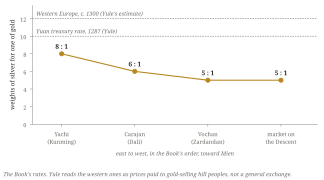

# Chapter II-8
## Mien and Bangala: Elephants, Battle, Towers of Gold and Silver

> *“But I was forgetting to tell you of a famous battle that was fought in the kingdom of Vochan in the Province of Zardandan, and that ought not to be omitted from our Book.”*
> — Marco Polo, Book 2, ch. 51 (Yule–Cordier)

**[M]**

---

Five weights of silver will buy one of gold in Zardandan (western Yunnan). If you have packed a mule-load of silver over the passes, that exchange rate is reason enough to risk the frontier road to Vochan (Baoshan). Yet the imperial court has far sharper business on that plain than weighing bullion. In Polo’s account, Cublay (Kublai) Kaan stations soldiers across Vochan and Carajan (Yunnan) to shield the border from southern raids [1]. The Book sets the clash in 1272 [2], shortly before the appointment of Sentemur (Esen-Temür), grandson of the Kaan through one of his dead sons [3]. Keep that year in mind while the horns blow. Before long, the *Yuan shi* chronicle will show us a later encounter with elephants, and we will follow this fight down to the oak tree where a bowman hitches his pony without being sure which battle we have just fought.

{#fig-silver-exchange}

Out of Mien (the kingdom of Bagan, in present-day Myanmar) marches a sovereign who owes the Kaan no homage. The Book grants him Bangala (usually read as Bengal, though its position is disputed) as well [4]. Word of the frontier garrison reaches his capital, and he advances with a vast host to crush it. Three days short of Vochan he halts to rest his army. A cavalryman can step down and loosen a saddle girth there. Now pause and look at the elephants like a Venetian merchant reading a timber invoice. A wooden fighting-castle has to ride square on an elephant’s back when the beast breaks from a walk to a trot. The soldiers packed inside must be able to draw bows and throw spears without fouling one another’s arms. Picture the seasoned timber, iron bolts, and leather belly-bands required for a single castle. Then multiply that carpenter’s order by the Book’s count.

Two thousand elephants, by Polo’s muster, carry wooden fighting-towers, each holding twelve to sixteen armed fighters [5]. Behind them march sixty thousand horse and foot [6]. Even from a mile away, a moving palisade of castles rising higher than city battlements gives any cavalryman plenty to think about. Out on the grass, it is the horses that make up their minds first.

Across the flat plain stand twelve thousand Tartar horsemen under Nescradin (Nasr al-Din) [7], drawn up beside a thick wood. At roughly a mile’s range, the King of Mien orders his tower-crews to take their stations and sends his whole line forward. Both armies advance until the Mongol ponies catch sight and smell of the towering beasts bearing down on them. They shy, wheel sideways, and refuse to face the elephants. Meanwhile the elephants keep striding steadily onward [8].

Down from the saddle. Nescradin commands his riders to dismount, lead their panicking horses into the trees, and hitch every rein fast to the trunks. On foot they sprint back to the edge of the open ground with bows strung. While the horses balked, those timber castles looked invincible; now, twelve thousand archers standing firm on two feet face an enormous expanse of living hide. Arrows fly thick from both lines, yet the Book hands the Mongols the sharp edge of the exchange. Fighters tumble from the upper towers, and wounded elephants wheel round in pain. Whole ranks bolt straight back toward the very wood where the Tartars left their mounts. Towers slam against stout boughs, leather girths snap, and timber castles splinter into kindling among the leaves [9]. The horsemen who rode out on ponies have just won back their chance to fight on horseback again.

Stand at the edge of that wood for one breathless moment. Out on the open plain you could watch the elephant line buckle. From inside the trees, you would hear the wooden towers shattering overhead before you even knew which way the beasts were running.

{#fig-ii-8-vochan-battle}

Vaulting back into their saddles, the Mongols charge the infantry and cavalry following behind. Swords and maces rise and fall amid a din loud enough to drown thunder. The king commands the larger host, yet the Mongols keep the steadier hand, until by midday the Mien line breaks. Cavalry chase the fugitives across the plain, then turn back toward the trees [10].

Catching a stampeded elephant is an altogether different craft from shooting one. Mongol troopers fell heavy trees to block the forest paths, yet they still need the king’s captured elephant-drivers to step near the terrified giants and calm them [11]. Polo counts more than two hundred beasts taken alive and makes this day the start of the Great Kaan’s own elephant herds [12]. Before the fight, those towers made the animals look like rolling fortresses. Once the fighting stops, a commander sizes them up as royal property—provided he has the fodder to feed them and the captive handlers to lead them home. There sits a conqueror’s true inventory: the most valuable prisoners on that field were the men who knew how to steer an elephant through the gates of Cambaluc (Beijing).

Set Polo’s 1272 battle beside the *Yuan shi* chronicles, and the arrow-storms are still flying even when the dates and counts pull apart. In the third month of 1277, the Chinese chronicle sets roughly seven hundred Yuan troopers under Hudu and his companions against forty to fifty thousand Mien soldiers and some eight hundred elephants [13]. Later that year, in the tenth month, the chronicle sends Nescradin out on a separate expedition with more than 3,840 soldiers to receive the submission of fortified settlements before heat forces a withdrawal [14]. In that Chinese clash of 1277, panicked elephants bolt into a thicket of sharp bamboo stakes while desperate riders prod them with the wood in confusion [15]. Both witnesses give us good reason to take elephant warfare along the Carajan border seriously. Yet whether both tellings describe the same field, or where the wood stood, remains a question arrows cannot settle.

---

After all that splintered timber crashes down, it is a relief to step back beside a quiet set of scales. Two and a half days of steady downhill riding beyond Vochan bring travellers to an open plain hosting a lively market three times every week [16]. People carry raw gold down from hidden mountain valleys without ever naming where it comes from. Any merchant with silver can buy one full weight of gold for five weights of his own metal [17]. Picture that hillside bazaar at dawn: baskets of rice, cloth, and pack-saddles spread out on mats while silent mountain traders weigh yellow dust against stamped silver bars. That profit pays handsomely for rough passes, and you could easily weigh out a second fortune if you packed enough silver. It still will not buy an invitation to follow the miners home—yet for a trader making his margin right where the scales stand, he scarcely needs to ask.

Beyond the downhill market, fifteen days of dense forest stretch ahead. Pack every grain sack on a mule before entering, because not a single village sits along Polo’s track where a traveller can buy a handful of rice. Wild elephants roam the trees alongside what the Book calls unicorns—the thick-skinned rhinoceroses Polo will inspect more closely further south [18]. After fifteen nights on carried rations, the trail opens onto Amien, which Polo calls the capital of Mien [19]. The Book gives the city its own language, idolatry, and subjects of the Great Kaan. Where that road lands on a modern map stays tricky. Fifteen days through trackless woods leaves far too few landmarks, and the distance and name pull mapmakers toward different river towns.

Listen before you look. A former king of Amien ordered two stone pyramid towers built beside his tomb. Each rises a good ten paces high with a rounded crown hung round with bells—gilded bells on one tower, silvered bells on the other [20]. Whenever wind sweeps across the plain, both crowns chime together while noon sun blazes off metal plating a full finger’s breadth thick across each tower [21] and across the tomb between them [22]. Pause over that paired touch of gold and silver bells. Plain bronze bells would have sung just as sweetly in the breeze, yet nobody walks away remembering plain bronze the way they remember a skyline ringing in two matching metals.

Hold your own finger flat against an imaginary masonry wall for half a second. No goldsmith needs a full finger-breadth of solid gold to make a stupa shine across a valley. A fraction of that thickness beaten into fine leaf catches noon sun for miles. Here, Rustichello’s storytelling turns gilded Burmese brickwork into solid bullion thick enough to slice.

Who takes all that gleaming treasure when Amien falls? In the Book’s playful telling, Cublay sends in a band of court musicians and jugglers under a captain and a company of men-at-arms [23]. Crediting acrobats and minstrels with conquering an entire kingdom would bring down the house at an autumn feast. Meanwhile, historical chronicles describe a royal campaign led by Prince Singtur in 1282–83 that sent Mien’s king fleeing from his capital [24].

In Polo’s tale, the conquerors send riders back to Cambaluc (Beijing) asking whether to strip the twin towers. Cublay commands them to leave every ounce of gold and silver untouched on the dead king’s memorial, respecting an old Mongol reluctance to lay hands on property dedicated to the dead [25]. So the wind keeps ringing those golden and silver bells above woods teeming with deer, wild cattle, and elephants—leaving a traveller with both a ghost story and a warning not to touch royal offerings [26].

---

Southward still in the Book’s geography lies Bangala. Polo places it near India, assigns it a tongue of its own, and marks its people as idolaters. Yuan forces were already marching to conquer it in 1290, when Marco places himself at court, though the conquest stayed unfinished [27]. Leave the campaigning regiments offstage and walk into Bangala’s bustling markets instead.

Cotton drives a trade all its own, flanked by ginger, galingale, spikenard, and cane sugar, while abundant rice, milk, and meat feed crowded towns [28]. Local cattle stand as tall as elephants, Polo claims, though he concedes a clear difference in bulk [29]. After Vochan, an elephant makes quite a yardstick to hold beside a cow. Yet not every cargo leaving these markets travels by choice. Indian merchants buy men and women captured in border wars alongside a thriving traffic in eunuchs supplying great households and the Kaan’s own barons [30]. A bale of cotton shows what the valley grows; the human captives marching down the road show where a darker share of the profit came from.

Gold and rumour travel onward from one frontier report to the next. East of Bangala, Polo sets a tribute-sending king in Caugigu (perhaps Kiang Hung, now Jinghong). Take a good look at the people of that country before you count a single coin in the king’s treasury. Roll up a townsman’s sleeve and glance at his forearm: out here, dragons and lions are drawn permanently into living skin.

---

## Notes

[1] ~ Polo describes the troops as a frontier garrison [@yc, 2.51]. Vochan is conventionally associated with Baoshan, while the battlefield itself remains disputed. See [Map A11, the southwest circuit](ch-07-tebet-carajan.md#map-of-the-southwest-circuit).

[2] ? The Book dates its engagement to 1272. Yule suspects a corrupt numeral and compares the 1277 elephant fight, whose resemblance cannot establish that the two accounts describe the same event [@yc, 2.51 n. 1; @yc, 2.52 n. 3; @yuanshi1370, juan 210].

[3] ~ Sentemur is Cublay’s grandson in this passage. The timing of the appointment relative to the fighting depends on the campaign chronology and cannot be recovered from Polo’s date alone [@yc, 2.51; @yc, 2.48 n. 1].

[4] ? Yule suspects some confusion between Bengal and Pegu. Phayre, quoted by Yule, argues that the Burmese kings might have claimed the title on dynastic grounds [@yc, 2.51 n. 2].

[5] ~ War elephants are attested in the Yuan account, while the timber towers and their crews of twelve to sixteen belong to Polo’s telling. Yule compares widely divergent crew sizes in accounts of war elephants and doubts whether so many fighters would have room to use their weapons [@yuanshi1370, juan 210; @yc, 2.51 n. 3].

[6] ? Sixty thousand is Polo’s tally for the Mien horse and foot. The Yuan figures for a possibly related engagement are forty to fifty thousand on that side [@yc, 2.51; @yuanshi1370, juan 210].

[7] ? Nescradin was the son of Sayyid Ajall and a Yuan commander in Carajan. The chronicle places him on the later expedition of 1277, under a different date and with a smaller force than Polo’s account gives him [@yc, 2.52 n. 1; @yuanshi1370, juan 210].

[8] ~ The refusal of the horses makes the dismount necessary in Polo’s account. Cordier’s comparison with Herodotus concerns animals balking in battle, while the mechanism here is the horses’ fright at elephants [@yc, 2.52 n. 2].

[9] ~ The Yuan account likewise sends the elephants flying under arrows. The tethered horses and splintered towers belong to Polo’s staging, and Baber’s attempt to locate the battlefield from its terrain is one proposal, reproduced in Yule [@yuanshi1370, juan 210; @yc, 2.52 n. 3].

[10] ~ The Yuan chronicle records a rout, while the sword-and-mace battle, its din and the midday pursuit are Polo’s [@yuanshi1370, juan 210]. Yule notes that the Burmese chronicle as reported to him omits the earlier engagement near Yung-ch’ang, leading Phayre to doubt it; the Burmese chronicle itself remains uninspected directly [@yc, 2.52 n. 3].

[11] ~ The trees felled across the animals’ path and the reliance on captured handlers are details in the Book’s account. By this stage it gives the prisoners’ expertise more weight than the cavalry’s skill [@yc, 2.52].

[12] ~ The total of more than two hundred is Polo’s figure. His account makes this the beginning of the Kaan keeping elephants in numbers, a neat origin story that the campaign evidence cannot date [@yc, 2.52].

[13] ✓ The *Yuan shi* records about seven hundred soldiers under Hudu, Xinjuri and Tuoluotuohai in the third-month fight. It gives their opponents about eight hundred elephants and forty to fifty thousand men, all on the Mien side [@yuanshi1370, juan 210].

[14] ✓ The chronicle assigns more than 3,840 men to Nasr al-Din’s expedition in the tenth month. It describes submissions at fortified settlements and a withdrawal owing to the heat [@yuanshi1370, juan 210].

[15] ~ In Yule’s relay of the Chinese account, the elephants flee into a place set with sharp bamboo stakes, which their riders seize and use to prod them. In Polo’s story the flight ends among trees, with the towers smashed [@yc, 2.52 n. 3; @yuanshi1370, juan 210].

[16] ~ The length of the descent and the three market days are Polo’s. Yule cites Sladen on a five-day market cycle in the Shan country, a parallel for regular markets with a different interval [@yc, 2.53 n. 1].

[17] ~ The five-to-one rate agrees with Polo’s figure for Zardandan. Yule’s note reports gold from districts north of Bhamo, while the account of the merchants’ bargain and the guarded route to the sellers’ homes is Polo’s [@yc, 2.50; @yc, 2.53 n. 1].

[18] ~ When the Book meets the animals it calls unicorns on Java Minor, it gives them the hide, horn and mud-loving habits of rhinoceroses. That description offers a reading of the name in the forest report [@yc, 2.53; @yc, 3.9].

[19] ? Yule’s notes compare routes via Nan-tien and towards the Salween, debate a starting point near Bhamo and discuss Pagán and Tagaung as possible termini. The fifteen-day itinerary on its own cannot decide between them [@yc, 2.52 n. 3; @yc, 2.53 n. 2; @yc, 2.54 n. 1].

[20] ~ The bell-hung *hti* canopies and gilding of Burmese stupas offer a visual parallel. Their likeness cannot identify these two towers or establish their funerary purpose [@yc, 2.54 n. 2].

[21] ✗ Finger-thick plating on a pair of towers is probably an exaggeration. Yule discusses the Mangala Chaitya finished in 1274 and the gold images associated with it as possible material for the story [@yc, 2.54 n. 2].

[22] ~ Ramusio-only in part. Yule brackets the plating on the tomb itself and the placement of a tower at either end, while the two towers and their metal coverings are already in the base account [@yc, 2.54].

[23] ✗ The entertainers’ conquest reads like court hearsay. Polo himself supplies the troupe with a captain, armed men and an army’s equipment [@yc, 2.54].

[24] ~ Yule identifies the prince of the 1282–83 campaign as probably Singtur and compares Chinese accounts of the advance with Burmese reports of Narathihapate’s flight in 1283–84. The latter reports describe temples dismantled to fortify the capital [@yc, 2.54 n. 2].

[25] ~ The order to spare the towers belongs to the conquest tale. Polo explains it by a reluctance to disturb the property of the dead, and the order itself has no independent confirmation here [@yc, 2.54].

[26] ~ Among the game in the Book’s account are deer and wild cattle. Yule reads the latter as gaur [@yc, 2.54 n. 3].

[27] ✗ Yule could find no dependable record of a Yuan attempt to take Bengal and doubted that Polo reached it from Carajan. Its position in the Book also sits awkwardly with Bengal’s place in India [@yc, 2.55 n. 1; @yc, 2.59 n. 6].

[28] ~ Polo names cotton as a mainstay of trade and lists the spices and food separately. The combination gives the report a recognisable commercial profile without fixing the position of Bangala [@yc, 2.55].

[29] ✗ Yule takes the comparison as a figure of speech. His note distinguishes accounts of the unusually tall wild buffalo from the domestic cattle Polo seems to mean [@yc, 2.55 n. 2].

[30] ~ Yule cites the *Āʾīn-i Akbarī* and Barbosa for the trade in Bangala and Ibn Baṭṭūṭa for the price of enslaved people. These comparisons support a traffic in people and leave the claim about supplying the Kaan’s barons with Polo [@yc, 2.55 n. 1].
