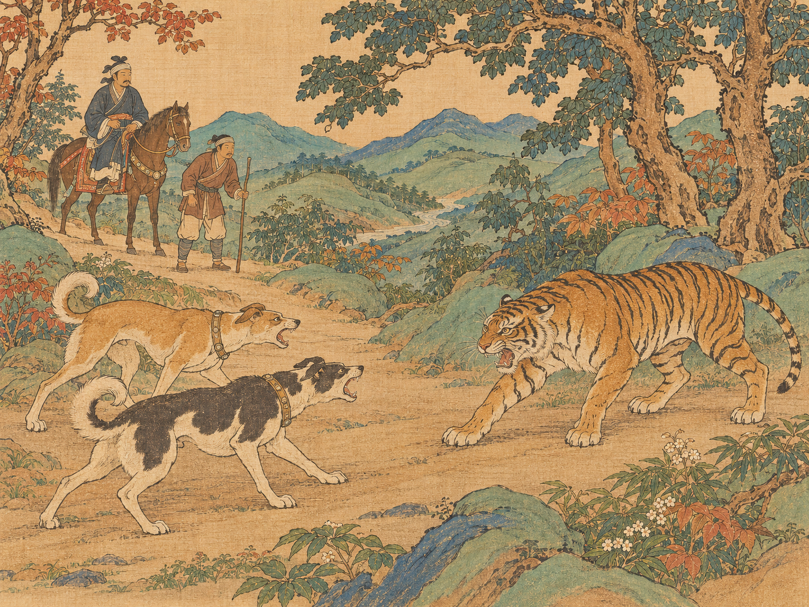

# Chapter II-9
## Caugigu, Anin, Coloman, Cuiju — and Back

> *“From Sindafu you set out again and travel some 70 days through the provinces and cities and towns which we have already visited, and all which have been already particularly spoken of in our Book. At the end of those 70 days you come to Juju where we were before.”*
> — Marco Polo, Book 2, ch. 59 (Yule–Cordier)

**[R]**

---

East of Bangala, the road crosses into Caugigu (perhaps around Jinghong, or farther south along the Upper Red River), thirty days’ march by Polo’s reckoning [1]. The people are idolaters with a language of their own, and the Book strings this province and the three after it along an eastward curve that will bend north-east back to Sindafu (Chengdu)—eighty-seven marches in all from Bangala to Sichuan, if you sum the stages as the manuscripts give them. Gold and spices sit plentiful and cheap in these valleys, for a reason any merchant who pays for his own pack mules understands at once. Far from the sea, overland carriage eats the profit clean out of bulky goods before a ship’s mast is ever in sight [2]. A bale of spice that would fetch a fortune on a saltwater quay sits heavy and cheap in a landlocked basin where every outward stage demands fresh silver for drivers, beasts, and fodder. What travels light, or pays its own way on four legs, is another matter.

Meanwhile, the king of Caugigu sends yearly tribute to Cublay (Kublai) at Cambaluc (Beijing) [3]. Before we count a single ingot in his treasury, catch a townsman’s bare forearm in the street. Lions, dragons, and birds run across his skin in permanent blue-black needlework, and they do not stop at the wrist.

See [the map of the southwest circuit, II-7](ch-07-tebet-carajan.md#map-of-the-southwest-circuit).

The countryside around his capital is richly stocked: tame elephants in great numbers, cattle of several kinds, and plenty of forest game, feeding people on meat, milk, rice, and a wine brewed from rice and spices [4]. The king’s household follows the same generous scale. Polo credits him with at least three hundred wives and the custom of marrying every noted beauty in his valleys [5]. It is Rustichello’s familiar shorthand for a distant throne: a sovereign wealthy enough in tribute and pasture to fill an entire palace with brides.

Look closer at that needlework on the streets. Nearly the whole population wears lions, dragons, and birds pricked permanently into face, neck, chest, arms, hands, and belly—laid in so deep they can never be washed out. To local eyes it is the height of elegance, so the man or woman with the finest embroidery draws the greatest admiration [6]. A Venetian visitor buttoned inside silk court sleeves hides his standing in his purse; here, a person’s status is written on living skin in plain daylight. For two hundred years mapmakers have slid Caugigu’s hazy borders back and forth between southern river towns and northern Vietnam [7], yet the Book’s eye locks straight onto what makes a stranger stare, even while leaving out how the ink was mixed, who held the needles, or what the patterns meant at home.

Push east out of Caugigu and you enter Anin (perhaps Jianshui, or an upland belt bordering Annam), a country of idolaters with their own tongue, subject to the Kaan and living by tillage and wide pastures. Here a horse dealer’s eyes sharpen immediately. Herdsmen raise oxen and buffalo alongside strings of stout hill horses sold in great numbers to buyers from India, making a handsome profit on the road [8]. Polo never forgets a horse market. He has watched them all the way from Hormos (Hormuz) to Carajan (Yunnan), and he knows that wherever Indian buyers climb into cool hills, silver moves uphill to pay for cavalry stock that hot coastal plains cannot breed for themselves. Anyone who lives by horse fairs knows what to ask at the gate: not how green the meadows look, but what Indian buyers are paying per head and whether the best strings have already gone south.

Money shines on wrists and ankles as well. Both women and men wear heavy bracelets of gold and silver, and Marco notices that the men’s bands outweigh the women’s [9]. A horse trader riding west from Anin remembers the price of a stout gelding; another traveller remembers the gleam of heavy gold on a man’s forearm. Two reports from the same market sound like two different countries, and neither one tells you much about the farmers tilling fields outside the gate.

Even the road length between Caugigu and Anin depends on which report lies open on the table—stretching from fifteen days’ journey in the oldest French copies to twenty-five in later Italian tellings [10]. Both counts rest on hearsay rather than a paced survey, leaving Anin sliding as freely across upland borders as Caugigu behind it [11]. Eight days’ march farther east—or north-east as the map bends—brings the road climbing into the steep hills of Coloman (provisionally the Guizhou or north-eastern Yunnan uplands) [12].

Coloman is rugged hill country, set among high mountains and tight natural passes. The Book describes its people as tall, handsome, and brown in complexion—stubborn fighters well able to hold their walled villages against any intruder [13]. After the open pastures of Anin, the track narrows between limestone crags where every settlement looks built for defence, and a rider’s eye shifts from horse herds to the steep approaches rising above the valley.

Tilt your head back inside one of those dark gorges and look up toward the cliff-tops. When someone dies in Coloman, the body is burned, the bones are gathered into little wooden chests, and climbers carry those chests up sheer mountain faces to hang inside great caverns where neither beast nor robber can reach them [14]. Think of the practical logic behind the rite: a full coffin could never scale a limestone wall, whereas a small chest of ashes and bone fits in a climber’s sling, lifting the dead permanently out of reach below. Stand at the bottom of a gorge and gaze up at those dark mouths in the rock. Whoever brought that story down to the caravan trail knew how to make a listener look skyward without needing to have climbed the cliff himself.

Down in the valleys, the living trade with two currencies side by side. Coloman yields gold, yet for everyday buying and selling its people count out porcelain shells—the white cowries we met back in Carajan—just as Bangala, Caugigu, and Anin do [15]. Wealthy merchants handle large consignments and eat well on meat, milk, rice, and spiced rice wine. Gold settles the wholesale bargains; cowries rattle in leather pouches for eggs and small groceries. Two monies sharing one counter show exactly how far a frontier market reaches before imperial paper takes over.

Twelve days’ travel along a rushing river out of Coloman bring the road into Cuiju (perhaps the Guiyang belt), gliding past towns and villages the Book skips over in a breath until you reach the large city of Fungul (possibly Yibin or Luzhou, though riverside towns vie closely) [16]. Any tidy anchorage looks clean enough inside an atlas square until you stretch medieval spellings across living water, and long arguments over upper-river towns and highland stations show how stubbornly these twisting gorges resist a single pin [17].

At Fungul, two things catch a merchant’s eye at once. First, locals weave cool, crisp summer garments out of tree bark [18]. A Venetian raised on wool and heavy silk knows how to judge a weave between thumb and forefinger, and a light summer stuff beaten from tree fibre earns its own line in his notebook. Second, cowrie shells vanish from the counter: here the Great Kaan’s black mulberry paper money is current once again, and the Book marks that boundary explicitly [19]. Pause over that single change of currency, because it tells you more than any carved frontier stone. Cowries belong to tributary borderlands; once stamped mulberry paper reappears in the till, you have crossed back inside Cambaluc’s fiscal world, where imperial tax clerks and governors hold the roads and river-fleets move silk toward northern markets [20].

Yet the riverbanks carry a warning pulled straight from Rustichello’s notebook. So many fierce striped tigers—the Book calls them lions—prowl the wooded gorges that no one dares sleep outside at night. Even travellers on the river must moor far clear of the bank, or a beast will leap aboard and drag a sleeping sailor into the dark [21]. Nobody could cross Cuiju safely, Polo insists, without a local pair of allies: huge, fierce mastiffs bred bold enough that two together will take on a tiger [22].

Watch how the pair goes to work on the trail. Every traveller leads two of these dogs along. When a tiger bounds into view, the hounds dart in and out, baying and snapping at its flanks while dodging every sweep of its paws until the beast turns to escape their din and backs into the woods to put a tree trunk behind it. While the dogs hold the stage in front, the travellers draw their bows and loose arrows until it drops [23]. It is a neat piece of theatre for a fireside audience in Venice, with the dogs holding the scene and the archers finishing the act. Meanwhile a real boatman poling through river fog asks simpler questions: where the current sets, where the shoals lie, and how far off the mudbank he needs to drop his anchor before dusk.

{#fig-ii-9-dogs-and-tiger}

Twelve more river stages past well-armed towns trading in paper money bring the traveller straight back to Sindafu (Chengdu) [24]. We have already walked its half-mile covered bridge, with its painted pillars and daily shop-stalls open from dawn till night, so Polo refuses to repeat himself. Instead he sends us seventy days north and east through cities and provinces the Book has already described—compressing two months of familiar roads into a single sentence until we stand once more at the milestone fork outside Juju (Zhuozhou) where the western road began [25]. A rider who has already paid those innkeepers and ferrymen once has no need to count them a second time.

Step outside Juju’s gate at sunrise and look back at the vast four-month loop the last four chapters have drawn. Tattooed valleys, horse pastures, cliff-hung bone chests, cowry markets, bark-cloth weavers, and tiger-baying mastiffs have all been threaded onto one mountain spoke back to Sichuan, and then seventy days of riding are folded up behind us like a map. Some of those stories came from the road itself; others were gathered around campfires or court tables and stitched onto the itinerary by days’ marches. Twelve convenient river stages close a mountain circuit whose exact bends mapmakers still trace today.

Now Volume II swings onto its second great spoke. Turn your horse’s head south-east out of Juju, away from the cool mountain passes and down onto the flat plain of Cathay (northern China). Settle your morning inn bill with the Kaan’s black paper notes, tighten your saddle girth, and ride four days through busy trading towns toward the walls of Cacanfu (Hejian) and the long eastern canal road into conquered Manzi (southern China) [26]. Ahead wait boiling salt pans, river weirs, and the twelve thousand bridges of the City of Heaven.

---

## Notes

[1] ? Thirty days east from Bangala to Caugigu comes solely from Polo’s itinerary [@yc, 2.56–2.57]. No independent medieval survey clocks a matching thirty-day road stage between Bengal and Yunnan or northern Vietnam.

[2] ~ Expensive overland carriage explains why gold and forest spices bought cheaply in remote interior valleys before touching maritime lanes [@yc, 2.56]. Polo treats caravan transport friction with a merchant’s eye for margin against travel time.

[3] ~ Yearly tribute delivered to Cublay expresses Suzerain submission in the Book’s diplomatic formula [@yc, 2.56]. Local Tai or northern frontier polities balanced formal Yuan homage with substantial upland autonomy.

[4] ~ Elephants, cattle herds, forest game, and spiced rice wine compose Polo’s standard Southeast Asian resource register [@yc, 2.56]. Each item fits subtropical Tai–Lanna or Upper Red River valleys without fixing one town.

[5] ~ Attributing at least three hundred wives and blanket royal selection of beauties reflects courtly stereotype rather than counted census [@yc, 2.56]. Rustichello regularly underscores distant kingship through extravagant domestic numbers.

[6] ~ Needle tattooing of dragons, lions, and birds across men and women fits Tai and upland Southeast Asian practice well [@yc, 2.56]. Yule notes comparable floral and mythical skin-pricking among Shan and Tai communities, though Marco omits the technique’s ritual role.

[7] ? Yule favoured Kiang-Hung (Jinghong) in southern Xishuangbanna, whereas Pelliot derived *Caugigu* from *Jiaozhiguo* (modern northern Vietnam) and pointed to Upper Red River manners [@yc, 2.56 n. 1; @pelliot1959notes, vol. 1, entry 128]. The split highlights how far border ethnography could drift along mountain trails.

[8] ~ Pasture-raised horses sold toward Indian markets along with oxen and buffalo belong to Polo’s regional trade report [@yc, 2.57]. Upland horse routes linking Yunnan and northern Indochina with Bengal and the coast are historically plausible.

[9] ~ Heavy gold and silver armlets and leg-rings worn predominantly by men preserve genuine upland ornament observation [@yc, 2.57]. Still, Polo turns selective frontier wealth into a blanket badge for the entire province.

[10] ? Textual manuscripts diverge sharply between twenty-five days (Ramusio) and fifteen days (Geographic French F text) between Caugigu and Anin [@yc, 2.57 n. 2]. Such wide numeric swings show route copyists working from shaky intermediate reports.

[11] ? Yule looked to Ami (Kaiyuan) in southern Yunnan while Pelliot traced the syllable toward Annam [@yc, 2.57 n. 1; @pelliot1959notes, vol. 1, entry 22]. Neither candidate cleanly satisfies all compass cues and itinerary counts simultaneously.

[12] ~ Eight days northward from Anin sets Polo’s climbing interval toward Coloman’s limestone hills [@yc, 2.57–2.58]. The figure anchors his return trajectory toward Sichuan even where the intervening stations blur.

[13] ? Yule placed Coloman in western Guizhou among Miao–Lo-lo borderlands, while Pelliot read a variant as *Tu-lao-man* along eastern Yunnan [@yc, 2.58 nn. 1–2; @pelliot1959notes, vol. 2, entry 363]. Admiration for the hill fighters’ stout fortresses reflects Polo’s own appraisal.

[14] ~ Cremation followed by packing bones into chests and hanging coffins inside high cliffs matches genuine southern upland customs [@yc, 2.58]. Suspended cliff burials along Guizhou–Sichuan karst gorges still survive archaeologically, though Polo compresses diverse practices into one picture.

[15] ~ Combining cowry shells for petty buying with gold bars for wholesale trade extends the monetary zone shared across Bangala, Caugigu, and Anin [@yc, 2.58]. Cowries circulated for small change across Yunnan into the early Qing period.

[16] ? Twelve river days bringing travellers to Fungul open the Cuiju stretch whose waters and port name remain disputed [@yc, 2.59 n. 1]. Whether the stage descended an upper Yangzi tributary or climbed from Guizhou affects every surrounding dot on the map.

[17] ? Fungul has been matched provisionally with Yibin (Suifu), Luzhou, or Phungan-lu across differing manuscript spellings [@yc, 2.59 n. 1]. Broader placements for Cuiju span central Guizhou (Guiyang) eastward into Guangxi or north toward Sichuan approaches.

[18] ~ Summer bark-cloth pounded and woven from fibrous trees reflects Polo’s keen commercial eye for regional textiles [@yc, 2.59 n. 2]. Yule adduces Chinese paper-mulberry and bast fabrics woven in the warm southwest valleys.

[19] ~ Re-entering the zone of the Great Kaan’s paper currency marks the Book’s administrative threshold back into core Yuan territory [@yc, 2.59]. Wherever cowries gave way to mulberry paper notes, direct imperial tax administration held sway.

[20] ~ Active river freight carrying raw silk and bulky merchandise along the Fungul–Cuiju channel belongs to Polo’s market inventory [@yc, 2.59 n. 5]. The detail prepares his swing back into Sichuan’s main trade trunk.

[21] ~ What Polo calls fierce river-bank lions dragging sailors off moored boats are tigers along forested gorges [@yc, 2.59 n. 3]. Yule notes that Marco regularly applies *leoni* to Asian tigers across wooded south China.

[22] ~ Travel safety resting on pairs of large hunting dogs ready to face big cats blends local guard-dog reputation with tall storytelling [@yc, 2.59 n. 4]. Yule adduces early travellers’ notices of formidable Sichuan and Yunnan mastiffs.

[23] ~ Cornering the cornered beast against a tree trunk while hunters finish it with arrows forms a classic Rustichello set piece [@yc, 2.59]. The staging owes more to European hunting romance than audited river-pilot logs.

[24] ? Another twelve-day river march from Fungul back to Sindafu closes the speculative southern loop [@yc, 2.59 n. 6]. Because neither starting point nor river channel is firmly fixed, that return span stays provisional.

[25] ? Sending the reader back seventy stages through northern lands already described echoes the opening route of Book II [@yc, 2.59 n. 7]. Yule suggests this massive loop preserves dim traces of a genuine imperial mission without proving every south-eastern bend.

[26] ✓ Juju is Zhuozhou south of Beijing, and Cacanfu four stages south-east along the flat corridor is Hejian [@yc, 2.59–2.60]. Rejoining the fork at Juju hands the narrative cleanly onto the eastern Manzi trunk road in Chapter II-10.
