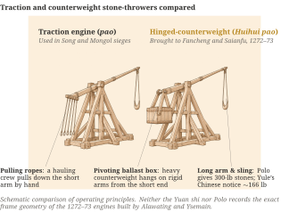

# Chapter II-11
## Yanju and Saianfu: Governorship Claim and the Mangonel Story

> *“And Messer Marco Polo himself, of whom this book speaks, did govern this city for three full years, by the order of the Great Kaan.”*
> — Marco Polo, Book 2, ch. 68 (Yule–Cordier)

**[M]**

---

Step ashore at Coiganju (Huai’an) and watch how one canal junction feeds an entire province [1]. Heavy river barges slide into its timber basins packed with northern wheat, pine logs, dried beans, and country produce. Fat hemp sacks of boiled salt file back out along radiating channels to provision forty dependent towns [2]. For any merchant keeping accounts, this quay shows at a glance what enters Manzi (southern China) and what fills the Great Kaan’s tax chest. Leave those shouting porters behind and climb onto a narrow stone-paved causeway rising high above endless water [3]. Wide flood basins, wind-stirred reed beds, and mirror-still lakes stretch clean to the skyline on both sides. Along this elevated stone spine runs the only dry-shod highway into the province, carrying every rider, porter, and pack beast above the marshes.

See [the map of the canal spine, II-10](ch-10-manzi-sung.md#map-of-the-canal-spine).

One day’s ride south-east along the stone embankment brings you to Paukin (Baoying), a prosperous town brisk with gold-and-silk weaving, paper currency, and artisan workshops [4]. Glance down over the stone parapet as hooves ring on paving: cottage roofs, willow dykes, and green paddies lie sunken far below the level of the canal water on either hand. A second day’s march leads to Cayu (Gaoyou), where the embankment still keeps travellers dry above wide silver lakes. Stop by the lakeside poultry baskets before dusk, because wildfowl and fish crowd the stalls cheaply enough to spoil any visitor’s appetite. For a single Venetian groat, Polo reckons, a hungry buyer carries off three fat pheasants, plucked or feathered [5]. A sharp traveller notices the price of a roasted bird as quickly as he measures the stone engineering holding his horse above the flood.

Push on a third day through unbroken villages and tilled fields to Tiju (Taizhou), a compact hub busy with shallow river skiffs and cargo boats [6]. Here the flat plain drops eastward toward the muddy tidal flats of the Yellow Sea. Three days off to the left hand, wide evaporation beds glitter around a richer salt town Polo calls Tinju (Nantong, though tidal yards closer to the canal leave the site open) [7]. Across every marshy settlement between the surf and Tiju, salt-boilers rake sea brine into glistening white ridges, firing enough fine salt to provision the whole province and pour silver into Cambaluc (Beijing).

Turn back onto the main trunk at Tiju and ride one final day south-east into Yanju (Yangzhou), one of the oldest and greatest commercial hubs of the empire [8]. Yanju oversees twenty-seven lesser cities, seats one of the Great Kaan’s twelve *Sings*, and quarters a permanent imperial garrison beside its wide moat. Inside its workshops, armourers and harness-makers forge weapons, shields, and horse-trappings for the Kaan’s troopers [9].

Then, right in the middle of an ordinary itinerary entry, the Book drops its boldest personal claim: Marco Polo himself governed Yanju for three full years by the Kaan’s direct order [10].

Pause outside Yanju’s salt warehouses for a moment and test that famous boast against hard paper. No Chinese chronicle, gazetteer, or Yuan biographical roll has ever supplied a record of Marco Polo holding office in Yanju [11]. Stranger still, even the medieval European copies quarrel over the single verb carrying the claim. One early French text reads *seingneurie*—he held lordship or governed there—whereas other early copies read *séjourna*, signifying merely that he resided three years inside the walls [12]. Later Venetian print tradition pushes the promotion furthest of all, seating young Marco in the high council chamber in place of an absent baron [13]. Watching copyists pull one slippery verb from “stayed” to “governed” to “stood in for a great lord” shows how easily a three-year posting grows into a viceroy’s chair on parchment.

Think about what Yanju actually was under Cublay (Kublai) Kaan. It served as headquarters of the vast Lianghuai salt administration. Inside its brick walls jostled tax gatherers, balance-masters, Persian brokers, Uighur secretaries, and imperial commissioners checking salt tallies against canal permits every day [14]. Stand on one of those timber wharves at sunrise and watch salt barges clearing customs: every bag carries a stamped ticket, and every ticket means silver for Cambaluc. Later fourteenth-century Latin gravestones uncovered in the city prove that other Italian merchants lived, traded, and died along these canals, though those carved slabs keep silent on the Polos [15]. A young Venetian accustomed to weights, prices, and tolls might easily have served a salt commissioner or carried an imperial audit warrant [16]. That is a believable kind of work to picture—and a long step short of proving he sat in a governor’s seat.

---

Before turning south toward the Yangzi, the Book swings sharply west to notice two great provinces standing clear of the main canal road. First comes Nanghin (Kaifeng), a broad territory overflowing with fine silk, gold brocade, cheap wheat and rice, abundant field game, and fierce cats the Book names as lions [17]. Merchant houses operate on an imperial scale inside its walls, packing bales of grain, dyed cloth, and raw silk while customs clerks log tolls on every wagon axle and river lighter. For generations European readers misplotted Nanghin far south along the Yangzi, yet its name preserves the historic Jin “Southern Capital” north of the river [18].

From Nanghin, the Book turns south-west toward a far grander prize: Saianfu (Xiangyang) and its twin river fortress of Fancheng across the Han [19]. Guarding the strategic corridor from northern China into the middle Yangzi plain, Saianfu ruled twelve subject cities and boasted busy silk looms, timber yards, and crowded markets [20]. According to Polo, it held out staunchly against Cublay for three full years after every other city of Manzi had yielded. Deep, broad waters ringed the fortress on three sides. That left the Great Kaan’s army only the northern strip of dry ground to trench and picket, while agile Song supply boats slipped rice, salt, and arrows through the blockade by night [21].

Here Rustichello clears the stage for a stirring family triumph. Gallopers ride north from the camp to Cambaluc, warning Cublay that his commanders cannot starve the town while victuals still slip past the pickets by water [22]. The Kaan replies impatiently that take the fortress they must, and devise a way how. Up step Niccolò, Maffeo, and young Marco before the imperial throne [23]. They promise the Emperor they can break the deadlock without waiting another season. Riding in their own train are two skilled Western masters, a German and a Nestorian Christian, who know how to build giant siege engines casting three-hundred-pound boulders across wide water [24].

Cublay eagerly bids them frame the engines with all his heart. Immediately the Polos call for seasoned oak and pine timber, measure heavy beams to true proportions, and direct their two craftsmen to build three towering counterweight trebuchets [25]. Palace carpenters mortise the trestles, rig thick twisted slings, and nail massive timber ballast boxes to the short arms inside the courtyard at Cambaluc. Once the court watches boulder after heavy boulder soar across the parade ground, an admiring Kaan orders the dismantled beams packed on carts, loaded with iron pins and tackle, and hauled southward to the muddy trenches before Saianfu [26].

Now watch the riverbank outside those stubborn walls. Mongol troopers stand back beside their earthworks as tall A-frames rise along the water. Windlasses haul the weighted boxes skyward, and iron triggers drop cleanly. Three monstrous stones scream across the channel and crash straight through glazed roof tiles, upper galleries, and timber storehouses inside the city [27]. Terrified townsfolk cry out that sorcery has rained upon their homes from empty sky. Gathering in council beneath splintered rafters, the defenders decide they are dead men if they linger another dawn. They agree to yield on the exact terms granted to Manzi. That famous victory, the Book boasts proudly, was won by Niccolò, Maffeo, and Marco alone [28].

{#fig-c14-trebuchet-comparison}

Wait beside those smoke-blackened trenches and open the dated calendar. Everything in that thrilling family rescue collides head-on with historical chronology [29]. Saianfu did not hold out for years after Manzi fell. Its gruelling siege ran from late 1268 until March 1273 and shattered the Song river shield *before* Bayan ever led his main columns south [30]. Worse still for the family’s credit, Niccolò, Maffeo, and Marco could not have reached Cublay’s court before late 1274 at the earliest, arriving around May 1275—more than two full years after Commander Lü Wenhuan unbarred the gates [31]. Even manuscripts that quietly drop young Marco’s name cannot rescue a siege that ended before his father and uncle rode back through Cambaluc’s gate.

Nor were Italian travellers’ camp followers the engineers behind that thunderous barrage. Both the *Yuan shi* and the Persian chronicler Rashīd al-Dīn agree that Cublay sent urgently to his nephew Abaga (Abaqa), the Ilkhan of Persia, begging for Western siege specialists, and Abaga dispatched skilled masters eastward [32]. In 1271, after three winters of stagnant river blockade, the Uighur commander Ali Haiya urged the court to summon artillerymen whose engines could cast heavy stone shot across the water. Chinese annals name two Muslim engineers sent from Persia, Alawating and Ysemain—linked either to Miafarakain and Herat or, by another reading of the Chinese characters, to Mausul (Mosul) and Serazy (Shiraz)—while Rashīd al-Dīn credits a Syrian master named Talib and his sons [33].

They tested their pivoted beams before Cublay in the capital, reached the Han River late in 1272, and trained their slings on the stubborn twin stronghold. First their volleys tore down the bridge piers and shattered Fancheng for storming columns in early 1273. Then carpenters shifted the timber frames round to hammer the south-eastern rampart of Saianfu [34]. The heavy shot in the Chinese record drove seven or eight feet into the earth—roughly 166 pounds by weight against Polo’s three hundred pounds [35].

{#fig-ii-11-xiangyang-trebuchet-turned}

Why did the Book place three Venetians behind Muslim counterweights? Chinese armies already used man-hauled traction trebuchets, whereas the heavy hinged-counterweight engine was the startling western breakthrough [36]. Think of the difference on the riverbank: instead of two hundred men hauling ropes in unison, a timber box packed with stone drops with mechanical precision. Marco makes the shattering effect of a three-hundred-pound shot vivid to a European audience without pausing over its mechanics. He likely heard the famous siege story told around Cambaluc’s tables after his arrival. How his family stepped into the Muslim engineers’ boots inside the Book’s pages remains one of the great puzzles of Rustichello’s workshop [37].

Take one last look across the wide Han River, where the broken twin fortresses stand fast in dated chronicles as the true hinge opening Manzi, while Rustichello’s wooden trebuchets stay locked inside proud family legend [38]. That western martial digression closes just as abruptly as it broke the southern canal march. Turn away from the smoke-blackened trenches and step back onto Yanju’s salt-whitened timber wharves at sunrise. Long narrow grain lighters and brine barges are already casting off their hemp hawsers down the side creek for the short fifteen-mile run to Sinju (Yizheng) on the wide brown breast of the Kian [39].

---

## Notes

[1] ✓ Coiganju is Huai’an (Hwai-ngan), standing at the strategic junction between the Huai waterways and the Grand Canal [@yc, 2.66 n. 1]. In Polo’s time the Yellow River emptied nearby into the Huai basin.

[2] ~ Distributing salt across forty cities reflects the scale of the Huai salt trade centered at Yancheng south of Huai’an, though forty is a round figure [@yc, 2.66 n. 1]. Vogel [-@vogel2013marco, ch. 5] underscores the immense share of Yuan fiscal revenue drawn from Jiang-Huai salt taxes.

[3] ✓ The raised stone causeway running along the canal embankment kept traffic above the low lakes and flooded paddies west and east of the road [@yc, 2.67 n. 1]. Nineteenth-century travellers noted that the surrounding plain lay up to twenty feet below canal water level.

[4] ✓ Paukin is Baoying (Pao-ying hsien), one day’s ride south-east along the stone embankment [@yc, 2.67 n. 1]. Its silk workshops and gold-thread textiles mirror the canal corridor’s specialized manufactures.

[5] ~ Cayu is Gaoyou (Kao-yu), bordered by Lake Gaoyou on the west [@yc, 2.67 n. 1]. Three pheasants for a Venetian groat is Polo’s familiar traveler’s price tag showing cheap abundance along the waterways.

[6] ✓ Tiju is Taizhou (Tai-chau), lying roughly twenty-five miles east of the canal trunk yet linked to it by navigable channels [@yc, 2.68 n. 1]. Its modest size contrasts with the bustling coastal salt ports beyond it.

[7] ? Tinju (written *Cingui* in the Geographic Text and Ramusio) remains unfixed [@yc, 2.68 n. 1]. Yule leans toward Nantong (Tung-chau) near the Yangzi estuary three days east of Taizhou, while Kingsmill proposed Yizheng (*I-chin*) and modern scholars also compare the Taizhou salt yards.

[8] ✓ Yanju is Yangzhou, one of the wealthiest commercial cities of medieval China, where Friar Odoric later found a Franciscan house and three Nestorian churches [@yc, 2.68 n. 2; @odoric1913travels, ch. 37]. Calling its subordinate towns twenty-seven is a formulaic round number.

[9] ~ Yanju briefly served as seat of a provincial *Sing* (*xingsheng*, government-general) in 1276–77 before becoming the capital of a *Lu* circuit [@yc, 2.68 n. 3]. Its armour and harness workshops supplied Yuan garrisons stationed across the lower Yangzi.

[10] ? Polo’s claim to have governed Yanju for three full years is one of the most contested personal assertions in the Book [@yc, 2.68 n. 3]. No Chinese chronicle, gazetteer, or Yuan biographical source mentions Marco Polo in Yangzhou [@vogel2013marco, ch. 1; @haw2006marco, ch. 11].

[11] ? The apparent appointment at Yanju is a claim of the Book. Wood discusses the gap in local records. The local evidence for Mar Sarghis at Chinghianfu is a separate case [@yc, 2.68 n. 3; @wood1995did, ch. 15; @moule1915christians].

[12] ? Manuscript witnesses divide sharply over Marco’s role: the Franco-Italian F text reads *seingneurie* (“governed”), while Bern and Pauthier’s MS C read *séjourna* (“stayed” or “sojourned”) [@yc, 2.68 n. 3; @moule1938description, vol. 1, p. 316]. Wood [-@wood1995did, ch. 15] accepts Yang Zhijiu’s preference for *séjourna* as more plausible while asking why even a foreign sojourner would escape local gazetteers.

[13] ? Ramusio-only in part. Ramusio’s 1559 edition expands the bare governorship claim into a story that Marco governed “in place of one of the said Barons,” which Yule treats as likely an editorial gloss [@yc, 2.68 n. 3]. Larner [-@larner1999marco, ch. 3] and de Rachewiltz [-@derachewiltz1997marco; -@derachewiltz2002wood] reject a full civil governorship while allowing a temporary court-appointed inspection or mission.

[14] ? Yule once dated Marco’s three-year stay to about 1282–1287 based on the “Po-lo” note under the Ahmad crisis in Chapter II-5, which actually refers to the Mongol official Bolad [@yc, 2.68 n. 3; @ycadd, on 2.23]. The city’s salt administration supplies context for the question of an office. The Bolad comparison cannot date a posting for Marco [@vogel2013marco, chs. 1, 5].

[15] ✓ De Rachewiltz [-@derachewiltz1997marco, p. 40] notes Latin-inscribed tombstones of Italians at Yangzhou—Caterina Vilioni (1342) and Antonio Vilioni (1344)—proving a later Latin merchant community there. Their graves attest an Italian presence a generation after Polo, not his own office.

[16] ? Vogel [-@vogel2013marco, ch. 1, p. 68; ch. 5, p. 348] considers residence and some temporary fiscal or inspection post in Yangzhou plausible while finding a formal salt-official post quite improbable; Haw [-@haw2006marco, chs. 11–12] proposes armaments administration or service under a Mongol-Turkic name. See [Back Matter II-1, “Trivia and Disputes”](back-01-trivia-and-disputes.md#disputed-claims--the-volume-ii-shortlist) and [Chapter III-12](../vol-3/ch-12-reliability-essay.md#famous-stress-points).

[17] ~ Polo’s description of Nanghin’s cheap grain, silk, gold tissues, and mercantile duties accurately fits a major central Chinese circuit [@yc, 2.69]. His reference to “lions” denotes striped tigers or regional hearsay rather than African lions.

[18] ✓ Pelliot [-@pelliot1959notes, vol. 2, pp. 789–791] firmly identifies Nanghin (*Nan-ching*) with Kaifeng, the Jin “Southern Capital” (*Nanjing*) and Yuan official name until 1288, rejecting Pauthier’s and Yule’s preference for Anqing [@yc, 2.69 n. 1]. Modern Nanjing bore the name Jiankang in Polo’s time.

[19] ✓ Saianfu is Xiangyang on the south bank of the Han River, paired with Fancheng opposite it on the north bank [@yc, 2.70 n. 5]. The name matches Rashīd al-Dīn’s *Sāyānfū* and guards the northern water gate into the Song heartland.

[20] ✓ Xiangyang’s twelve dependent towns and silk wealth fit its historical importance as the key to the Han–Yangzi corridor [@yc, 2.70 n. 5]. Wylie even obtained a buried Song copper coin uncovered at Xiangyang dating from the siege.

[21] ✗ Polo frames the siege as a three-year postscript *after* the rest of Manzi had yielded, a reversed chronology repeated by Waṣṣāf [@yc, 2.70 n. 5]. In reality, the blockade ran from late 1268 to March 1273 as the crucial opening phase of the Song conquest.

[22] ✓ Chinese annals confirm that the Uighur general Ali Haiya urged Cublay in 1271 to summon western siege experts because river supply lines kept Xiangyang and Fancheng alive [@yuanshi1370, juan 128, 203; @yc, 2.70 n. 5]. See [Timeline B4, Song endgame](ch-10-manzi-sung.md#fig-b4-song-endgame).

[23] ✗ Neither Niccolò, Maffeo, nor Marco Polo could have advised the siege or arranged the engines [@yc, 2.70 n. 5]. Even under the most generous Prologue chronology, the three Venetians reached Cublay’s court about May 1275, more than two years after Xiangyang fell.

[24] ✗ Crediting a German and a Nestorian Christian in the Polos’ household is a Book invention, absent even from some manuscript variants that omit Marco from the scene [@yc, 2.70 n. 5]. Larner [-@larner1999marco, ch. 3] observes that the Xiangyang and Yangzhou boasts may owe much to Rustichello inserting personal drama into city lists.

[25] ~ Ramusio-only in part. Ramusio notes the Polos offered to build engines “in the Western fashion” (*al modo di Ponente*), while Pauthier’s MS C falsely asserts China had never seen mangonels before [@yc, 2.70 nn. 1, 5]. In truth, Mongol and Chinese armies already used traction (man-hauled) engines, whereas the heavy *counterweight* trebuchet was the western breakthrough [@yc, 2.70 n. 3].

[26] ✓ Testing the newly built trebuchets before Cublay at Cambaluc before hauling them south matches the *Yuan shi* record of the Persian engineers’ demonstration [@yuanshi1370, juan 203; @yc, 2.70 n. 5]. The court trial established the range and weight of the counterweight engines before they were dispatched to the Han River front.

[27] ~ Polo reports three-hundred-pound stones. Yule reads the figure in the Chinese account as 125 Chinese pounds and estimates about 166 pounds avoirdupois if the unit is the catty [@yuanshi1370, juan 203; @yc, 2.70 n. 5]. The mechanical impact on wooden roofs and masonry towers was nonetheless decisive.

[28] ✗ Instant terror and immediate surrender compress a gruelling double assault [@yc, 2.70 n. 5]. Fancheng was stormed first in early 1273 (the 1st month), and Xiangyang’s commander Lü Wenhuan yielded weeks later in the 2nd month after the heavy shot shattered the south-eastern corner towers [@yuanshi1370, juan 7–8, 203].

[29] ✓ The chronological clash between March 1273 and the Polos’ arrival in 1275 is decisive against family participation [@yc, 2.70 n. 5; @yc, Introduction § 19]. Even Pauthier’s attempt to push the advice back to the elder brothers’ first journey fails against the text’s post-conquest setting.

[30] ✓ Both the *Yuan shi* and Rashīd al-Dīn place the fall of Xiangyang squarely before Bayan’s 1274–76 drive into Manzi [@yuanshi1370, juan 7–8; @thackston1998rashiduddin, p. 450; @boyle1971successors, pp. 290–291]. See [Back Matter II-1, “Disputed claims”](back-01-trivia-and-disputes.md#disputed-claims--the-volume-ii-shortlist).

[31] ✓ Yule stresses that the three Polos could not have reached Cublay before the close of 1274 at the earliest, and places their court arrival around May 1275 [@yc, 2.70 n. 5; @yc, Introduction § 19]. That arrival date falls two full years after the historical surrender of Xiangyang.

[32] ✓ Chinese and Persian records agree that foreign artillerymen came from the Ilkhanate at Cublay’s request, though they name different specialists [@yuanshi1370, juan 203; @thackston1998rashiduddin, p. 450]. Rashīd al-Dīn credits an engineer named Talib (from Baalbek or Damascus) and his three sons Abubakr, Ibrahim, and Muhammad with building seven catapults.

[33] ✓ The *Yuan shi* names the two Muslim engineers sent by Abaga as Alawating (ʿAlāʾ al-Dīn) and Ysemain (Ismāʿīl) [@yuanshi1370, juan 203]. Inside Yule–Cordier, Yule renders their origins as Miafarakain and Herat, whereas Parker in Cordier’s addenda proposes instead Mausul (Mosul) and Serazy (Shiraz) [@yc, 2.70 n. 5; @ycadd, on 2.70].

[34] ✓ The chronicle places Alawating and Ysemain’s arrival at the siege late in 1272, followed by the storming of Fancheng in the first month of 1273 and Xiangyang’s surrender in the second month [@yuanshi1370, juan 7–8, 203]. Each phase of the final bombardment is dated in the official Yuan annals without any European involvement.

[35] ~ Yule gives the impact depth as seven or eight feet and makes his conversion conditional on the unit. The Book’s larger figure is a separate report [@yc, 2.70 n. 5; @yuanshi1370, j. 203].

[36] ✓ Favé and Yule discuss the engines known in China before the siege. Polo’s account stresses the size of the shot and its effect [@yc, 2.70 nn. 2–5].

[37] ? The historical siege predates the Polos’ arrival at court. How they acquired the story and which writer gave their family a role are open questions [@yc, 2.70 n. 5; @larner1999marco, chs. 3, 5].

[38] ✓ Historical records confirm that Xiangyang and Fancheng served as the decisive hinge opening Manzi, even though the Polos played no role at the siege [@yc, 2.70 n. 5]. Once the twin river fortresses yielded, Bayan's armies could advance down the Han into the Yangzi valley.

[39] ✓ Yule notes that the copyist’s error *Angui* in the Geographic Text at the opening of Chapter LXXI must read *Iangui* (Yanju), linking Yangzhou directly to the nearby river port of Sinju [@yc, 2.71 n. 1]. Correcting that single initial restores the actual fifteen-mile connection between the canal capital and its Yangzi shipping port.
