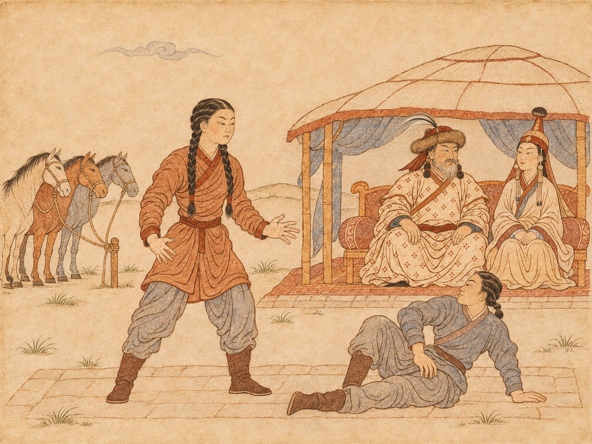
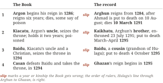

# Chapter II-15
## Great Turkey, Caidu’s Daughter, and the Wars of the Ponent

> *“In GREAT TURKEY there is a king called CAIDU, who is the Great Kaan’s nephew… Now this King Caidu is never at peace with his uncle the Great Kaan, but ever at deadly war with him.”*
> — Marco Polo, Book 4, ch. 1 (Yule–Cordier)

**[R]**

---

Step away from the pepper wharves of Zayton (Quanzhou) for one final act before the sea voyage begins. Lift your eyes from the customs ledgers to the wind-scoured steppes. The harbours of Manzi (southern China) and the cities of Cathay (northern China) pour an empire’s ransom into the imperial treasury every season. When King Caidu (Kaidu) demands his ancestral share of Cathay and Manzi, there is half a world’s revenue at stake. Cublay (Kublai) Kaan offers to grant him a rich province on the exact terms given his own sons, with one firm condition: Caidu must ride to court and kneel in homage. Out across the steppe, Caidu sends back a dry answer. He is entirely willing to obey the Emperor from right where he sits in the saddle [1]. A man who already commands half the steppe has no mind to trade his own war-horse for a court stool in Cambaluc (Beijing). Now we watch how rival Mongol princes keep the borders blazing while southern ships are fitting out for sea.

Where Caidu sits—the Book’s Great Turkey (the Central Asian khanates), stretching north beyond the Jon (Oxus) on the road up from Hormos (Hormuz)—he commands princes of the blood of Chinghis (Genghis) Kaan. By Polo’s muster, he can put a hundred thousand horsemen in the field, forcing Cublay to keep frontier armies camped under arms year-round [2]. An appanage inherited from your grandfather’s sword and a province handed out at another ruler’s pleasure are two very different things to a steppe king who means to keep his stirrups.

{#fig-mongol-horizon}

Trace the family tree quickly before the horses wheel into line. Polo styles Caidu as Cublay’s nephew and grandson of Sigatay (Chagatai). In fact, Caidu’s father Kashin was Ögedei’s son—making Cublay his father’s cousin rather than his uncle, and turning rival imperial claims into a bitter dynastic feud [3].

In 1266, by Polo’s dating, Caidu and his cousin Yesudar ride out and rout two barons loyal to Cublay, who escape only on swift horses. Two years later Caidu strikes again, facing Cublay’s son Nomogan (Nomukhan) and a prince named George on a wide plain near Caracoron (Karakorum) [4]. Each side draws up six divisions of ten thousand riders. Before the drums roll, look inside a steppe trooper’s quiver: thirty light arrows for long-range volleys and thirty heavy broadheads for close work [5]. Notice how practical that count is: light shafts thin an enemy charge from afar, while broadheads slice bowstrings and horse-armour once the lines lock. When both kettledrums boom, arrows darken the sky until quivers hang empty. Men draw swords and maces and hack until dusk. Neither host breaks; at dawn Caidu slips away upon hearing imperial reinforcements are riding up [6]. Later annals confirm Nomogan’s capture by rebel princes on another occasion, leaving this particular field floating somewhere across the northern steppe.

---

The next string of horses in Caidu’s corrals is not booty from a battlefield, but a young woman’s wrestling purse. Her name is Aijaruc (Khutulun), meaning Bright Moon [7]. Any suitor who throws her wins her hand. Any suitor she throws forfeits a hundred horses. Ten thousand steeds have already changed hands when a proud prince rides into the hall willing to stake a full thousand horses on one bout [8]. Her father and mother privately beg her to let him win, yet she holds out for the exact wager she set every other challenger.

Step onto the smooth palace flagstones and watch them lock arms. The prince wears a fitted tunic of sendal; Aijaruc wears one of heavy silk sammet. For long breathless minutes neither budges an inch, muscles straining under rich silk. Suddenly she hooks his heel and slams him flat onto the stone floor [9]. The prince rides out poorer by a string of cavalry mounts, and Caidu’s daughter adds another thousand horses to her herds.

{#fig-ii-15-aijaruc-wrestling}

Spare a thought for the palace grooms leaning on the courtyard rail during that match. One prince hitting the flagstones means a thousand extra mouths to water and feed before sunrise. Out on real campaigns, Polo’s Aijaruc darts out from her father’s squadron and plucks an enemy officer straight from his saddle like a stooping falcon. Rashid al-Din’s chronicle confirms that Caidu’s daughter rode to war beside her father [10], even if the thousand-horse marriage wager belongs to Eurasian folktale.

---

Across the western marches of Persia, the Book shifts south to the Ilkhanate frontier around the Arbre Sec (the Dry Tree), where Abaga (Abaqa) sets his son Argon (Arghun) on guard. Polo sends Barac (Baraq) riding over the river as Caidu’s brother. In truth Barac was a Chaghadaid prince and ally who died in 1271, eleven years before Abaga’s death in 1282 [11]. In storytelling, eleven quiet years collapse into a single breath between campaigns.

Forty days’ ride separate Argon from the Persian capital when news arrives that his father is dead. Closer to the treasury sits Argon’s Muslim uncle Acomat Soldan (Ahmad Tegüder), who seizes the throne and opens the coffers to buy barons and captains with gold [12]. Watch where that gold goes while rivals exchange long chivalric speeches. Acomat is showering coin on the very officers his nephew will have to win back. Every chest of silver carried out of the treasury is meant to nail down a crown—yet bought loyalty has a short memory when a stronger prince rides closer.

When the armies clash, Argon is defeated and clapped in irons [13]. Acomat rides off in triumph toward court, leaving his army and his fettered prisoner in the keeping of a commander called the Melic. Nights later, a knot of high barons—Boga (Buqa), Elchidai, Togan, Tegana, Tagachar, Oulatay (Ulatai), and Samagar—slip inside the prisoner’s tent. At first Argon thinks their offer to crown him a cruel jest until they swear solemn oaths of allegiance. Off come the iron fetters. The barons loose arrows into the Melic’s pavilion, and Argon rides out at the head of the very army that hauled him there in chains [14]. Picture the sudden reversal in the torchlight outside that tent: an hour ago Argon waited for an executioner’s bowstring, and by dawn the captains who guarded his chains are riding behind his standard. Fleeing toward Egypt, Acomat is captured and put to death in August 1284—two years earlier than the Book’s 1286 accession date for Argon [15].

From his throne, Argon dispatches his son Casan (Ghazan) to guard the Khorasan border with thirty thousand horse [16]. When Argon dies in March 1291, Casan stands far away on the frontier. Kiacatu (Geikhatu)—Argon’s own brother, though the Book styles him an uncle—seizes power that July and takes wives from Argon’s tents before meeting murder in 1295 [17]. Baidu, a cousin through their uncle Tarakai, snatches the crown that spring before losing his army and his life to Casan in October 1295 [18]. Follow that tangled succession across the chart and watch how many bloody turns it takes for a father’s crown to reach his son. Every death on the Persian throne clears one more step toward the day Casan will write to the Great Kaan for a bride.

{#fig-c8-ilkhan-succession}

---

A single fine sable skin pulls our eyes north again from Persian battlefields into the frozen forests of Conchi (Kunchi). His nomadic subjects roam wide plains without city or fortress, tendering meat offerings to felt images of Natigai and his wife who watch over their herds [19]. Here white bears, black foxes, wild asses, and sables roam dark pine woods. All summer, hunters dine on abundant little burrowing marmots Polo names Pharaoh’s rats [20].

Climb onto a courier’s sledge across thirteen days of frozen bog and ice where no wheeled cart could turn an axle. The sledge sits flat on the snow without runners, lined with a shaggy bearskin seat and pulled by six big dogs trained to haul straight from post to post. Ahead trots the station-keeper in his own sledge to pick the safest track [21]. Picture the sheer grit of that run: frozen breath, yelping dogs leaning into leather traces, and pine timber scraping over crusted snow. At every relay, fresh dogs harness up while the old team trots home. It is a winter mirror of the empire’s southern horse-posts adapted cleanly to ice and mire.

Trappers in nearby valleys dig underground homes against the frost to snare ermine, black fox, and sable [22]. Beyond them lies the Land of Darkness, locked in perpetual winter twilight. Raiders slipping into that gloom ride nursing mares and tether their foals at the light’s edge, trusting maternal instinct to guide them back out through the dark laden with plundered pelts [23]. Meanwhile peaceful fur merchants wait safely in the daylight to buy skins straight from the hunters.

Along the border of Rosia (Russia), Polo catches sight of another fur market in Lac (possibly Wallachia), home to Christians and Muslims alike [24]. Rosia itself holds silver mines and Greek-rite Christians paying tribute to Toctai (Toqta), lord of the western Tartars of the Ponent [25]. The Book strings their khans from Sain and Patu—splitting Batu’s honorific “Good” title and personal name into two separate rulers [26]—through Barca (Berke), Mungletemur, and Totamangul down to Toctai. By then, the narrative tangles two rival brothers’ fathers mid-sentence as they demand justice against Nogai. Historical chronicles follow that civil war through more than one pitched battle, with the two commanders’ fortunes reversing between them [27].

For a heartbeat Polo pauses right at the strait entering the Black Sea, where Venetians, Genoese, and Pisans already drop anchor every season. Then he turns away from coasts his own countrymen know too well [28]. Any sailor leaning on a Rialto bollard can name the Black Sea headlands. Who on the quay can tell him about six-dog bearskin sledges crossing thirteen days of frozen mire?

One final clash awaits before we reach salt water. Between the Iron Gates (Derbend, now Derbent) and the Sea of Sarain (Caspian Sea), Alaü (Hülegü) and Barca pitch rival camps ten miles apart, deliver grand speeches, and collide. In this telling, Alaü drives Barca from the field [29]. Follow history back to the frozen Terek River in the winter of 1262–63, however, and the tide runs the other way. Barca’s horsemen smashed Alaü’s army under Abaga and drove them onto cracking river ice where hundreds drowned [30]. That very winter war sealed the western caravan road behind Niccolò and Maffeo Polo. Caught on the wrong side of the front, two Venetian gem-merchants turned east into the entire world we have just crossed.

Now Volume II closes its continental map and turns back toward open sea. Leave the steppe warhorses and dog-sledges behind at the water’s edge, and step back onto the warm granite seawall at Zayton, where four-masted merchant junks are hoisting sail for the Indies. A traveller can book a private wooden cabin with a locking door above the deck. Directly beneath his floorboards waits a fir hull split into thirteen watertight compartments, ready to carry us out onto the monsoon oceans of Volume III.

---

## Notes

[1] ~ Polo gives the rival claims the form of a demand and a conditional offer. The struggle between Caidu and Cublay is historical, while the exchanges are preserved here as the Book tells them [@yc, 4.1 nn. 1–2].

[2] ~ Yule cites Rashid al-Din on the expanse of country held between the rival powers. Polo’s hundred thousand is his estimate of Caidu’s whole strength [@yc, 4.1 n. 2].

[3] ✗ Caidu was Ögedei’s grandson through Kashin. Yule suggests that Caidu’s influence among the princes of Sigatay’s line may explain the Book’s mistake [@yc, 4.1 n. 1].

[4] ? Polo dates the first fight to 1266 and places the later fight against Nomogan and George near Caracoron. Pelliot doubts the identification of the latter and suggests that the Book may have put George in place of his father Ai-buqa [@yc, 4.2; @pelliot1959notes, vol. 2, “Nomogan” and “Giorge”].

[5] ~ The allocation of arrows belongs to the Book’s description of how mounted archers equip themselves. Each kind has a job, from long-range shooting to close work with a head that can cut a bowstring [@yc, 4.2].

[6] ? The Book’s second battle ends without a victor. The Yuan chronicle reports that other princes seized Nomogan at Almaliq in 1277 and says Caidu did not join them. The capture is a separate event in the record and leaves the narrated battle unidentified [@yc, 4.2 n. 3; @yuanshi1370, juan 12; @pelliot1959notes, vol. 2, “Nomogan”].

[7] ✓ Yule identifies the name in the Book as a Turkish expression for the shining moon. Through Hammer he identifies Caidu’s daughter as the Khutulun named by Rashid al-Din [@yc, 4.4 n. 1].

[8] ~ The escalating stakes and the running count belong to Polo. They give the audience a way to measure the size of the final wager [@yc, 4.4].

[9] ? The court match has the shape of a folktale, with the prince’s thousand horses at stake. Yule compares Ibn Baṭṭūṭa’s account of Princess Urduja, who wanted a husband able to defeat her in combat, and leaves open a possible connection between the stories [@yc, 4.4 n. 1].

[10] ✓ Rashid al-Din’s account, as relayed by Yule through Hammer, puts Khutulun in the field with her father. The comparison supports her presence on campaign; the hawk-like capture is Polo’s scene [@yc, 4.4 n. 1].

[11] ✗ The Book turns Barac, a ruler from Sigatay’s branch, into Caidu’s brother and telescopes the fighting with the change of rulers. Barac died in 1271, years before Abaga’s death in 1282 [@yc, 4.5 n. 2; @yc, 4.6 n. 1].

[12] ~ Acomat’s conversion and accession belong to the historical succession; the distribution of the treasury to win over the army is how the Book stages his claim. Polo treats the conversion as central to the quarrel and gives the rivals elaborate speeches [@yc, 4.6 nn. 1–3; @yc, 4.7–11; @yc, 4.17 n. 1].

[13] ✓ Yule’s comparisons support Argon’s defeat and capture. The Book leaves him in irons in the hands of a commander whose title it renders as Melic [@yc, 4.12 nn. 1–2].

[14] ~ Boga and his allies secured Argon’s release and his rise to power. Yule identifies several of the men and suggests that Polo may later have heard the story from Oulatay, who went east as Argon’s envoy [@yc, 4.13–14; @yc, 4.17 nn. 1–2].

[15] ✗ Acomat was executed on 10 August 1284, so Argon’s reign begins in 1284. The Book gives 1286 [@yc, 4.15–17; @yc, 4.16 n. 1; @yc, 4.17 n. 2].

[16] ~ The sources Yule compares put Casan in charge of the eastern provinces. The Dry Tree and the figure of thirty thousand cavalry belong to Polo’s telling [@yc, 4.17 n. 2].

[17] ✓ Kiacatu was enthroned on 23 July 1291 and put to death in spring 1295. Yule’s account names two women from Argon’s royal tents who became wives of his brother [@yc, 4.18 n. 1; @thackston1998rashiduddin, pp. 575, 580–581, 586].

[18] ✓ Baidu’s father Tarakai was a son of Alaü, making Baidu a cousin of Argon and Kiacatu. Baidu was executed on 4 October 1295 and Casan was enthroned that November, a year after the date the Book gives for both reigns [@yc, 4.19 nn. 1–2; @thackston1998rashiduddin, p. 627].

[19] ~ Yule identifies Conchi with a prince of the Jochid line. Polo presents the felt figures and the tending of their mouths as inherited customs reaching back to Chinghis Kaan [@yc, 4.20 n. 1; @yc, 1.54].

[20] ? Yule compares marmots and other burrowing animals in discussing the Pharaoh’s rat. The name and the subsistence detail in the Book leave its identity uncertain [@yc, 4.20 n. 2].

[21] ~ Yule compares dog transport in northern Asia with the relay described by Polo. The precise lengths, teams and sizes belong to the Book’s account [@yc, 4.20 n. 3].

[22] ~ The Book links underground dwellings to the severity of the cold. Its lists of pelts give the northern account a commercial point of contact with other regions [@yc, 4.20 nn. 4–5].

[23] ~ The mare and foal give the tale a way to navigate the legendary darkness. Trade in northern furs is plausible independently of the Book’s explanation of how raiders went after them [@yc, 4.21 nn. 2–3].

[24] ? The Book places Lac at the edge of Rosia and calls its population religiously mixed. Yule proposes Wallachia, with reservations about which region the name designated [@yc, 4.22 n. 2].

[25] ✓ Polo gives Rosia the Greek rite and names Toctai as its overlord. The general setting fits the tributary relations of the Rus’ principalities with the Golden Horde [@yc, 4.22 n. 1].

[26] ✗ Yule reads Sain, meaning “good”, as an epithet of Patu. The Book has turned a title and a name into two rulers, and its list compresses later successions as well [@yc, 4.24 nn. 1–2; @yc, 4.29 n. 1].

[27] ? The text alternates between Tolobuga and Totamangu as the brothers’ father. Yule compares accounts of Toctai’s defeat by Nogai and Nogai’s later defeat, with differences in the chronology [@yc, 4.29 n. 1; @yc, 4.30–33].

[28] ~ The Book first breaks off at the entrance to the Black Sea, then gives the familiarity of the route as its reason for passing over the coast. In Yule’s edition the northern and western reports come after the voyage through the Indian seas [@yc, 4.23; @yc, 4.34].

[29] ✗ The Book gives victory to Alaü’s side and magnifies both armies. The family’s eastward journey belongs to the Prologue, and its account also puts Alaü on the winning side [@yc, 4.25–28; @yc, Prol. 2].

[30] ✓ Yule distinguishes the better-attested Terek campaign from the Book’s victory for Alaü. Abaga, commanding for his father, was driven back in the winter of 1262–63. The war closed the way back for the brothers in the Prologue. See [Chapter I-2, “The House of Polo and the Elder Voyage”](../vol-1/ch-02-house-of-polo.md) [@yc, 4.25 n. 3; @yc, Prol. 2 n. 3].
