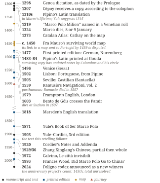

# Chapter III-11
## Afterlives: Maps, Columbus, and the Making of a Witness

> *“…he bethought himself that it would be a very great pity did he not cause to be put in writing all the great marvels that he had seen, or on sure information heard of, so that other people who had not these advantages might, by his Book, get such knowledge.”*
> — Marco Polo, Prologue, preamble (Yule–Cordier)
>
> *“…all the pavement of the Palace, and the floors of its chambers, are entirely of gold, in plates like slabs of stone, a good two fingers thick…”*
> — Marco Polo, Book 3, ch. 2 (Yule–Cordier)

**[reception]**

---

### A world on parchment, 1375

Marco’s chest of keepsakes had scarcely been inventoried before his words turned into gold leaf on Majorcan vellum. Unroll the painted Catalan Atlas in the French royal library and watch prose become geography. Dated to 1375 and associated with the Majorcan workshop of Cresques Abraham, its western panels trace crisp Mediterranean ports, headlands, and radiating compass lines any pilot could steer by [1]. Follow those vellum sheets eastward, however, and sea-charts give way to crowned monarchs, camel caravans, mountains, and rivers drawn from travellers’ testimony. Here names lifted from Marco’s *Book* take their place on the same piece of parchment as rulers whose courts and rites no Majorcan draughtsman had ever seen, turning pages of dictated memory into a painted panorama of Asia.

Across those eastern panels sit Cathay (North China), Carajan (Yunnan), Mien (Burma), and Bangala (Bengal) lettered cleanly in ink [2]. A caravan legend marches from Sarai toward Cathay in the exact sequence of a merchant road without naming which real travellers rode it [3]. Think how a map alters a story about travelling from one kingdom to the next. In a book, dozens of pages separate two cities; on vellum, a reader holding one kingdom in mind can look right across a painted border and see its neighbour waiting beside it, asking how two distant realms sit together in space. Those painted roads invite us to trace one man’s clean itinerary across Asia, yet look closer and a portolan coastline drawn from pilot logs sits right beside an inland kingdom copied from hearsay [4]. See [the caravan and its inscription in the closing essay](ch-12-reliability-essay.md#fig-atlas-caravan).

Bookshelves tell a parallel story inside private houses. Wills and inventories put copies of Polo into the hands of merchants, court readers, and religious houses across Europe. Yet surviving records show that merchant ownership alone does not establish commercial use: provenance traces point just as often to maps, world histories, and religious writings [5]. Owning the *Book* in a counting-house did not mean a merchant used it like a port-book; on painted vellum and in private libraries alike, readers turned Marco to purposes of their own, from princely curiosity to monastic geography.

### A friar’s map and a traveller’s book

By the mid-fifteenth century, a Venetian Camaldolese monk crammed an even wider stock of travellers’ talk onto one sweeping circular mappamundi. Fra Mauro’s surviving map in Venice’s Marciana Library teems with marginal notes so dense you must lean close over the parchment to read what each place meant to the man who lettered it. It includes an early named island related to Polo’s Chipangu (Japan), placing eastern islands into European cartography long before Portuguese sails rounded Malacca [6]. An archival record dated 24 April 1459 notes a map despatched on a Portuguese royal commission, though how that lost sheet relates to the surviving Marciana circle remains an open puzzle [7]. Knowing the date a workshop shipped a parchment leaves open which exact circle survived in Venice.

Later cartographers shuffled Polo’s names like chessmen to make room for fresh Portuguese sea logs. In one 1522 map, Polo’s river Pulisanghin near Cambaluc (Beijing) migrates far northward into the Arctic under the name *Polisacus* [8]. Worse still, mapmakers trying to reconcile overland reports of Cathay with coastal Portuguese news of China sometimes split them into two separate countries—keeping Cathay in the north while planting China down south [9]. Once engraved on copperplate, a displaced river or doubled empire looks far surer than any manuscript guess, leaving later readers to untangle which names had drifted across oceans and latitudes. A reader holding both a printed chart and a manuscript travelogue had to decide whether to trust the engraver’s neat coastline or the traveller’s memory.

### Print and the Admiral’s margins

In 1477, Nuremberg presses turned Marco into a German printed book—allowing any buyer to own a copy without waiting for a nobleman’s scribe—followed by an Augsburg reprint in 1481 [10]. Between 1483 and June 1484, Gerard Leeu printed Francesco Pipino’s Latin translation at Gouda, putting a Dominican’s neat prose onto booksellers’ shelves across Europe [11]. By 1496 Giovanni Battista da Sessa issued a Venetian printing [12], and in 1502 a Portuguese edition appeared at Lisbon bound beside Niccolò de’ Conti’s Asian travels [13]. A year later, in 1503, Rodrigo de Santaella’s Castilian translation came off Seville presses [14]. A bookseller who bound two travellers under one cover let a reader compare a port in Polo against a port in Conti; a scholar with Latin in one hand and Castilian in the other could watch names shift between languages and weigh every variant for himself.

Walk into Seville’s Biblioteca Colombina today and open one surviving copy of Leeu’s Latin edition. Marginal ink beside the print belongs to Christopher Columbus and his circle, tracking ports, spices, and distances across the Asian chapters [15]. Turn straight to Chipangu: on fol. 57v, Columbus’s own pen notes Marco’s gold-plated palace floors and rose-coloured pearls [16]. A merchant’s letter from John Day in 1497–98 mentions sending a Polo volume to the Admiral, though Day’s phrasing leaves the exact book and reading date open [17]. That uncertainty matters if we ask what Columbus had actually read when pitching his westward voyage. Watch what the Admiral’s pen underscores on that Chipangu page: bullion, pearls, spices, and islands worth reaching [18]. Before 1492, Columbus’s knowledge of Cathay and Chipangu came chiefly through Paolo dal Pozzo Toscanelli’s 1474 correspondence, so we can see plainly what caught his eye in Seville even when we cannot follow his ink back before the first voyage.

{#fig-colombina-notes width=78%}

Anthologies soon swept Polo into wider currents. In 1532 Basel’s *Novus Orbis* printed him among New World and Asian voyages [19]. Then in 1559, the second volume of Venice’s grand printed *Navigationi et viaggi* collection gave Europe both the San Giovanni Grisostomo homecoming feast and a composite Italian text blending witnesses [20]. That posthumous Venice volume set Marco inside a grander company of travellers while reminding editors to keep room on the desk for the manuscripts it wove together. Twenty years later, in 1579, John Frampton printed the first English translation in London—worked not from Italian or Latin, as later editors traced, but from Santaella’s Castilian [21]. An English reader opening Frampton met Marco through a chain of translators reaching back from London to Seville.

{#fig-b5-reception}

### An overland test, 1603–07

At Peking, the Jesuit Matteo Ricci deduced from overland and coastal reports that medieval Cathay and Ming China were the very same empire [22]. To settle the question on the ground, Bento de Góis set out overland from India, crossed the Pamier (Pamir Plateau) late in autumn 1603, and reached Suzhou inside China’s frontier before dying in 1607 [23]. Changing a name on a European chart takes an afternoon once the news arrives; walking across the Pamir to ask a caravan master what Cathay means takes years. Once that four-year trek proved that overland Cathay and seaborne China met on the same soil, readers could finally judge Marco’s itinerary against one unified map.

Even with geography settled, argument over Marco’s credibility flared early. In 1688 the Jesuit Gabriel de Magalhães published a spirited defence of Marco’s presence in China, while in 1747 the English geographer John Green pointed sharply to the Book’s silence on the Great Wall [24]. Locating Cathay on a map answered where Marco’s places stood; it never settled what a visitor ought to have noticed once inside. From the seventeenth century onward, admirers and sceptics kept testing the Venetian’s pages against what later Europeans saw with their own eyes.

### Editors and readers in two centuries

Nineteenth-century scholarship turned the *Book* into a monument of comparative commentary. A landmark annotated English translation appeared in 1818 [25], followed in 1871 by a richly glossed edition later enlarged at the turn of the twentieth century [26]. Open those volumes on any contested stage: three lines of Polo sit atop three pages of Persian chronicles, Chinese gazetteers, and rival etymologies. Those comparative notes let a reader trace an entire library of witnesses even when an editorial verdict remains open to dispute, giving English readers not just a translation, but a whole workshop of nineteenth-century geography and history.

Twentieth-century editors shifted focus from places back to manuscripts. A 1928 Italian critical edition, a 1938 composite English collation, and posthumous philological notes taught readers to ask which witness carried a phrase before arguing what it meant [27]. A single word might appear in two versions and vanish in a third, forcing scholars to compare manuscripts line by line rather than trust one handsome volume. Meanwhile Chinese scholarship entered the dialogue directly through partial (1929) and complete (1936) Chinese translations alongside an annotated 1936 version [28]. In 1941, a study of a Ming-era *Yongle dadian* notice linked three Persian envoys with Cocachin’s return—spurring decades of comparison with Rashīd al-Dīn even as later critics noted that neither record names a Polo [29].

Imagination kept pace beside philology. In 1972, *Invisible Cities* seated Marco and ageing Cublay (Kublai) Kaan in an imperial garden where every city became a meditation on memory, desire, and empire [30]. Sitting beside Marco’s own travelogue on a shelf, that dialogue asks what happens when a traveller tries to describe a city his emperor will never see. Fiction borrowed the pair that mapmakers and editors had argued over for centuries, turning an old imperial audience into a modern meditation on language.

### A question in public, 1995

In 1995, a brisk, widely read challenge asked *Did Marco Polo Go to China?*—highlighting the absence of Polo names from Chinese and Persian embassy records, Persian place-names, and missing details like tea, foot-binding, and the Great Wall [31]. The reply came across disciplines: sinological rebuttal challenged the Great Wall objection in 1997 [32], route and zoological analysis tested the Chinese itinerary in 2006 [33], and a monumental fiscal audit brought Yuan salt and paper-money records to bear in 2013 [34]. Once a specialist question reaches general readers, every answer must show why an argument over a salt tax or an official title carries weight. That debate is weighed point by point in [the closing essay](ch-12-reliability-essay.md#the-frances-wood-debate-and-principal-replies).

Editorial tools keep sharpening too. A critical edition of the early Venetian redaction appeared in 2019, followed by a facsimile of Sessa’s 1496 printing and an ongoing digital critical edition uniting early witnesses [35]. Knowing which witness introduced a detail—and when a later compiler stitched two versions together—changes how we read every sentence. In 2024, Venice’s Palazzo Ducale staged a major seventh-centenary exhibition alongside new archival and textual studies [36]. Visitors walking past silks, coins, and manuscripts could ask anew what kind of proof survives for a merchant who left almost nothing in his own hand. That September, the *Le vie di Marco Polo* project announced a newly identified codex in Foligno—the 145th known manuscript in its census at the time [37]. Even a census of surviving books can still grow when someone opens an overlooked volume on a library shelf.

Seven centuries on, turn from that newly identified Umbrian codex to open the final courtroom ledger on what in this seven-hundred-year-old Book holds up. Every generation brings its own maps, editions, and sharp questions to the Book’s first-page pledge—to weigh what one Venetian saw with his own eyes against what he heard along the road.

---

## Notes

[1] ✓ The Atlas is associated with the Majorcan workshop and was later in the French royal library. Yule discusses the manuscript kept in Paris, with Cordier’s reference to the study of the atlas of Charles V [@liscak2018atlas; @yc, Introduction § 84].

[2] ✓ Yule lists these names and prints a reproduction of part of the map. His estimate of how far Polo supplied its information is an interpretation of the names and drawings [@yc, Introduction § 84].

[3] ✓ The caravan legend is part of the Atlas. It supplies neither named Polos nor an identified party of historical travellers in the particular scene [@liscak2018atlas].

[4] ~ The Atlas sets information from several routes and traditions together. The identification of individual contributions calls for comparison of each part [@liscak2018atlas; @yc, Introduction § 84].

[5] ✓ Gadrat-Ouerfelli examines ownership and gives examples of identifiable uses. She finds that the surviving evidence for merchant ownership does not by itself establish commercial use [@gadrat2024read, pp. 201–211].

[6] ✓ Fra Mauro gives an early named depiction of Japan. The surviving map dates broadly to the middle of the fifteenth century [@yc, Introduction § 85; @liscak2018atlas].

[7] ? The Venetian despatch is dated 24 April 1459 and concerns the map commissioned for Portugal [@yc, Introduction § 85; @liscak2018atlas]. Its exact relationship to the surviving Marciana planisphere remains debated in the cartographic literature [@falchetta2011fra, pp. 114, 122–24, 127–32].

[8] ✓ Yule identifies the Polisacus on a map of 1522 as the river named Pulisanghin in the Book. Its depiction as flowing into northern waters is one of the displacements he describes [@yc, Introduction § 85].

[9] ~ Yule follows the survival of a separate northern Cathay alongside information about China in a series of maps. He treats it as one of the effects of fitting new and inherited information together [@yc, Introduction §§ 85–86].

[10] ✓ The German edition was printed at Nuremberg in 1477 and reissued at Augsburg in 1481. Cordier gives a description of the editions [@yc, vol. 2, Appendix H].

[11] ✓ The catalogue dating for the Latin printing by Gerard Leeu is 1483 to 11 June 1484. The text in that edition is Pipino’s Latin [@polo1484consuetudinibus].

[12] ✓ Cordier lists the 1496 Venetian Italian printing by Giovanni Battista da Sessa, recently reissued in critical facsimile [@yc, vol. 2, Appendix H; @polo2024sessa]. That Venice incunable kept the vernacular Italian branch in print alongside Leeu's Latin.

[13] ✓ The 1502 Lisbon Portuguese edition printed by Valentim Fernandes pairs Marco Polo with the eastern travels of Niccolò de’ Conti [@yc, vol. 2, Appendix H]. Publishing the two Venetian travellers together framed Portuguese expansion into the Indian Ocean.

[14] ✓ The Castilian edition of Rodrigo de Santaella appeared in Seville in 1503. Cordier also records the later reprint at Logroño [@yc, vol. 2, Appendix H].

[15] ✓ The surviving copy is in the Biblioteca Colombina, Seville. Shawcross describes the annotations by Columbus and others in his circle [@polo1484consuetudinibus; @shawcross2023materiality].

[16] ~ Gil assigns the gold and red-pearl notes on fol. 57v to Columbus. The Book’s measurements and description of the palace are given in the base text of the Chipangu chapter [@gil2006marcocristobal, p. 30; @yc, 3.2].

[17] ? Gil relates John Day’s letter to the Seville copy and argues for a particular period of reading. The reference in the letter leaves the identification open [@gil2006marcocristobal, pp. 25–27, 30–34; @larner1999marco, ch. 9].

[18] ~ Shawcross finds a concentration on material things in the Admiral’s notes. Their date and sequence remain uncertain, and Yule notes that Columbus’s pre-1492 information on Cathay and Chipangu came largely at second hand through Toscanelli’s 1474 letters [@shawcross2023materiality; @gil2006marcocristobal, pp. 25–27, 30–34; @yc, Introduction § 74 n. 3].

[19] ✓ Cordier lists the 1532 Basel *Novus Orbis* among the printed sources of the Book. A Paris edition followed that year [@yc, vol. 2, Appendix H].

[20] ✓ Ramusio died before the second volume appeared in 1559. The edition includes his preface and a composite version of the text [@ramusio1559navigationi; @ramusio2015viaggi; @yc, vol. 2, Appendix H].

[21] ✓ Cordier lists Frampton’s English version of 1579 and gives Marsden’s identification of its Castilian source. The exact Castilian impression is left between the Seville and Logroño editions [@yc, vol. 2, Appendix H].

[22] ✓ The studies describe Ricci’s identification of Cathay with China and the sequence leading to the overland mission. Ricci had already reached that view by the time Góis set out [@feng2006cathay; @hosne2018cathay].

[23] ✓ Yule places Góis on the plateau late in 1603. The studies of the mission give his death at Suzhou in 1607 [@yc, 1.32 n. 2; @feng2006cathay; @hosne2018cathay].

[24] ✓ Gadrat-Ouerfelli discusses Gabriel de Magalhães’s 1688 defence, John Green’s 1747 Great Wall objection, and the early enlightenment disputes over Polo’s testimony [@gadrat2026marco]. Those seventeenth- and eighteenth-century debates anticipated the modern arguments over omissions in the text.

[25] ✓ Cordier lists William Marsden’s 1818 English translation at the head of modern annotated scholarship [@yc, vol. 2, Appendix H]. Basing his English on Ramusio, Marsden pioneered the systematic comparison of Polo's toponyms with Asian history and philology.

[26] ✓ Henry Yule’s first edition appeared in 1871, and Henri Cordier’s 1903 revision and 1920 addenda expanded its comparative notes across two volumes [@yc, Prefaces; @yc, vol. 2, Appendix H]. Yule–Cordier remains the baseline English commentary from which this edition works.

[27] ✓ Luigi Foscolo Benedetto (1928), A. C. Moule and Paul Pelliot (1938), and Pelliot’s posthumous *Notes* established modern stemmatic and philological commentary, surveyed by Larner [@benedetto1928milione; @moule1938description; @pelliot1959notes; @larner1999marco, chs. 3, 6]. Their collations shifted the field from treating the Book as a single text to comparing its distinct manuscript families.

[28] ✓ Ma Xiaolin traces the publication of Zhang Xinglang’s partial (1929) and complete (1936) Chinese translations alongside Feng Chengjun’s 1936 annotated translation of Charignon's French edition [@ma2025chinese]. Those works brought *Il Milione* into direct conversation with twentieth-century Chinese historical scholarship.

[29] ✓ Ma discusses Yang’s 1941 study and the comparison later made by Cleaves. Neither the Chinese notice nor the Persian record names the Polos, as Jackson notes. See [Chapter III-9](ch-09-cocachin-return.md) for the embassy [@ma2025chinese; @jackson1998travels, pp. 98–99].

[30] ✓ Calvino’s *Le città invisibili* was first published in 1972 [@gadrat2026marco; @bnf2023calvino, p. 4]. The imagined dialogues between Marco and the ageing Kaan belong to modern literary reception rather than the medieval text.

[31] ? Wood argues that the absence of the family’s names from eastern records, Persian place-names, and omissions such as tea, foot-binding, and the Wall tell against Polo’s presence in China [@wood1995did, conclusion; @jackson1998travels, pp. 98–99]. Her 1995 book brought long-standing specialist questions to a wide popular audience.

[32] ✓ Igor de Rachewiltz published his direct sinological reply to Wood in 1997 and summarised its conclusions in his 2002 ANU paper [@derachewiltz1997marco; @derachewiltz2002wood]. He challenged the Great Wall argument and defended the plausibility of Polo's service under Kublai.

[33] ✓ Stephen Haw examined chronology, routes, animals, plants, and place-names across Yuan China in his 2006 study [@haw2006marco, ch. 4]. His analysis emphasizes the coherence of Polo's environmental and geographic observations along the Chinese circuits.

[34] ✓ Hans Ulrich Vogel brought Yuan fiscal, salt, and paper-money records to bear on Polo’s reliability in 2013 [@vogel2013marco, ch. 1]. His monograph compares the Book's monetary, salt-production, and revenue figures detail by detail with Chinese administrative sources.

[35] ✓ The 2019 critical edition of V, the 2024 Sessa facsimile, and the developing digital integral edition make separate contributions to reconstructing the early witnesses [@simion2019devisement; @polo2024sessa; @simion2024integral]. Together they allow readers to inspect how individual redactions diverged across northern Italy.

[36] ✓ The Palazzo Ducale exhibition ran from 6 April to 29 September 2024. Recent documentary and editorial work includes editions of the records and manuscript studies [@curatola2024mondi; @formentin2024codice; @orlando2025novita].

[37] ✓ The *Le vie di Marco Polo* project announced the Foligno witness, Jacobilli A.II.9, on 6 September 2024 [@simion2024integral; @orlando2025novita; @levie2024foligno]. The number 145 represents the project's reported manuscript census total at that date.
