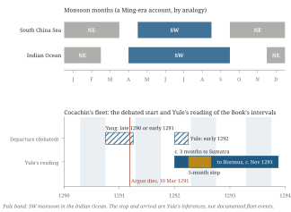

# Front Matter III-1
## The Indian Ocean World (and Why a Princess Boards a Ship) {short="The Indian Ocean World"}

> *“And when the ships had been equipt…”*
> — Marco Polo, Prologue, ch. 18 (Yule–Cordier)

---

::: howto
**Reading the marks.** Notes open with ✓ corroborated · ~ plausible · ✗ probably wrong · ? contested (◇ marvel or hearsay). Tags: **[V]** mostly seen or done · **[R]** mostly heard · **[M]** both · **[reception]** the Book's afterlife. A provenance label such as “Ramusio-only.” or “Ramusio-only in part.” in a Note identifies material from a later witness and defines its scope. Full key: Volume I, front matter.
:::

Trade your horse-post saddle for a fir deck built with thirteen watertight compartments. Volume II carried us down the paved highways and canal locks of Cublay (Kublai) Kaan’s empire to the crowded customs sheds of Zayton (Quanzhou). Volume III leaves the dry land behind and takes the monsoon road home.

Out on these salt waters, the Book changes gear twice. For its first eight chapters, it reads like a master pilot’s sea-chest—half sober merchant cargo list, half wide-eyed shipboard folklore. You will inspect the four-masted ocean junks of Manzi, hear the fateful harbour rumour of Chipangu (Japan) and its two-finger-thick gold palace floors, run south-west before the winter wind to Chamba (Champa) and Java, wait five months inside a timber stockade on Java the Less (Sumatra) for the monsoon to turn, climb the iron chains of Seilan (Sri Lanka), watch naked pearl divers and Brahman shark-charmers in Maabar (Coromandel), and trace the western rim of the ocean from diamond gorges and pirate fleets to the giant *Ruc* of Madeigascar (Mogadishu / Madagascar) and the scorching wind-catchers of Hormos (Hormuz). Then, in Chapter III-9, the periplus snaps back into gripping personal memoir: the two-year wedding voyage of the Mongol princess Cocachin (Kököchin), the imperial errand that cost hundreds of lives at sea and finally brought three weathered Venetians home in 1295.

And when the travellers step off the gangplank in Venice at the end of Chapter III-9, the Book makes its final pivot. Chapters III-10 through III-12 tell the seven-hundred-year biography of *Il Milione* itself—from ruby-stuffed coats at Ca’ Polo and Christopher Columbus’s ink margins in Seville to the modern courtroom where historians and archaeologists weigh what in this remarkable book holds true.

### Maritime Asia as a season, not a highway

The Indian Ocean and South China Sea of Polo’s day were crossed not by drawing a straight line on a chart and hoping, but by **monsoon logic**. Summer and winter winds reversed; captains waited in sheltered havens for the turn of the breeze; a missed season could strand a fleet for months. When the Book says the Polos wintered five months in Java the Less, that wait is seamanship, not idleness. Freight, diplomacy, and survival obeyed the same wind calendar [1].

Ports strung along the coasts like a merchant necklace: Zayton and Manzi; Chamba; Malay and Sumatran kingdoms; Seilan; Maabar and Melibar (Malabar); Gozurat (Gujarat) and Kesmacoran (Makran); then Arabia’s incense harbours and Aden’s Red Sea gate. Some of these Marco’s fleet touched; many others came from pilots’ talk in the shipboard evenings that fill wonder-books, which is why each chapter keeps `[V]` and `[R]` clearly in view [2]. Camphor from Fansur, pepper from Coilum (Quilon), pearls from Maabar, warhorses shipped to Indian courts, frankincense from Dufar—the cargoes anchor the coast even where a personal landfall is soft.

### What “India” means in the book

Polo’s “India” is wider than any modern map. It is a sailor’s vast arc from the seas below China around to the African coast—pearls, pepper, horses, saints’ tombs, Brahmans, pirates, and wonder-tales included. Later travellers such as Ibn Baṭṭūṭa and Duarte Barbosa confirm many coastal customs without proving Marco stepped ashore at every port in the periplus [3].

### Chipangu and the gold rumour

Before heading south, Volume III opens with ocean shipbuilding and the island of Chipangu—Japan as gold-roof harbour rumour. Marco never set foot there. The Mongol invasions of 1274 and 1281 are solid history; the two-finger-thick gold palace floors are Fujian dockside marvel turned up high for European ears—and later underlined in a Latin copy by Columbus, though when he made those margin notes remains uncertain [4].

### Ilkhanid marriage politics — why Cocachin matters

The homeward push is statecraft, not homesickness. In the Book’s frame, the Polos win leave to depart only by escorting **Cocachin** by sea to Persia for a royal marriage in the house of Argon (Arghun). Persian and Chinese records confirm that Argon’s envoys brought the princess from the Kaan’s court to marry Casan (Ghazan), though neither record names the Polos [5]. What mattered to the storytellers was that an imperial bride commission pointed straight home toward Hormos, Trebizond (Trabzon), and Venice [6].

{#fig-c11-monsoon-overview}

### Wonder-coasts and soft edges

Not every shore in Volume III carries the same weight. Seilan’s peak and Maabar’s pearl banks rest close to checkable custom; the dog-headed men of Angamanain, the twin islands of men and women, and Madeigascar’s *Ruc* belong to medieval wonder-lore riding the same monsoon swell. We keep the marvels onstage and audit them backstage in the Notes [7].

### What you are about to read

Chapters III-1 to III-8 sail the ships, islands, and spice coasts. Chapter III-9 returns to personal memoir aboard Cocachin’s fleet. Chapters III-10 and III-11 follow the Book’s Venetian homecoming and European afterlife, and Chapter III-12 closes the entire three-volume performance with the reliability ledger and our Modern Colophon.

The overland road became a sea-road, and under a Mongol princess’s wedding commission, the sea-road became the way home. Out on the roadstead off Zayton, a four-masted fir merchantman is riding at her cables with sixty private cabins under deck and dockers waiting to batten down the hatches. Step aboard—and let us look first into the hold below your feet.

---

## Notes

[1] ✓ Monsoon wind reversals governed every sailing schedule across the South China Sea and Indian Ocean [@hall1985maritime; @chaudhuri1985trade]. Polo’s five-month wait on northern Sumatra (Java the Less) matches the seasonal rhythm between the north-east and south-west monsoons; see [Chart C11, the monsoon](#fig-c11-monsoon-overview).

[2] ? Many islands and western coasts in Book III are described expressly from pilots' and merchants' reports rather than personal landfalls [@yc, 3.1–40]. The `[V]`, `[R]`, and `[M]` chapter tags and individual Notes distinguish likely ports of call along the Champa–Sumatra–Ceylon–India route from outlying hearsay.

[3] ~ Polo divides “India” into Greater, Lesser, and Middle India across an arc running from Champa to Abyssinia [@yc, 3.30 n. 2, 3.34 nn. 6–7, 3.35 n. 1]. Later travellers such as Ibn Baṭṭūṭa and Duarte Barbosa confirm many of the coastal customs he records without establishing that Marco landed at every port in the periplus.

[4] ~ The Mongol invasions of Japan in 1274 and 1281 are firm historical campaigns, whereas the gold-plated palace of Chipangu belongs to Fujian quay rumour [@yc, 3.2–3; @rossabi1988khubilai, chs. 4, 8]. For Columbus’s undated marginal annotations on Chipangu in his Seville Latin copy, see [Chapter III-1, Note 31](ch-01-ships-chipangu.md#notes) and [Chapter III-11, Notes 15–18](ch-11-afterlives.md#notes).

[5] ✓ Rashīd al-Dīn confirms that Argon’s envoys brought Kököchin from the Great Kaan’s court to marry Ghazan at Abhar [@thackston1998rashiduddin, p. 606], and a 1290 *Yongle dadian* provisioning entry names the three envoys matched by Yang Zhijiu [@ma2025chinese]. Neither source names the Polos or details the sea passage, and the fleet's exact departure year remains debated; see [Chapter III-9, Notes 13 and 21–22](ch-09-cocachin-return.md#notes) [@jackson1998travels, pp. 98–99].

[6] ~ Heavy passenger mortality at sea and the overland journey from the Persian Gulf through Trebizond to Venice in 1295 rest on the Prologue narrative [@yc, Prol. 18]. Maffeo’s 1310 will independently corroborates a financial loss at Trebizond; see [Chapter III-9, Note 27](ch-09-cocachin-return.md#notes).

[7] ~ Book III interleaves verified commercial staples—sappanwood, camphor, pearls, pepper, and Arabian warhorses—with classical and Arab maritime folklore such as the dog-headed men of Angamanain and the *Ruc* of Madeigascar [@yc, 3.13, 3.33]. Keeping the marvels in the narrative while marking their provenance in the Notes honors the Prologue's division between sight and report.
